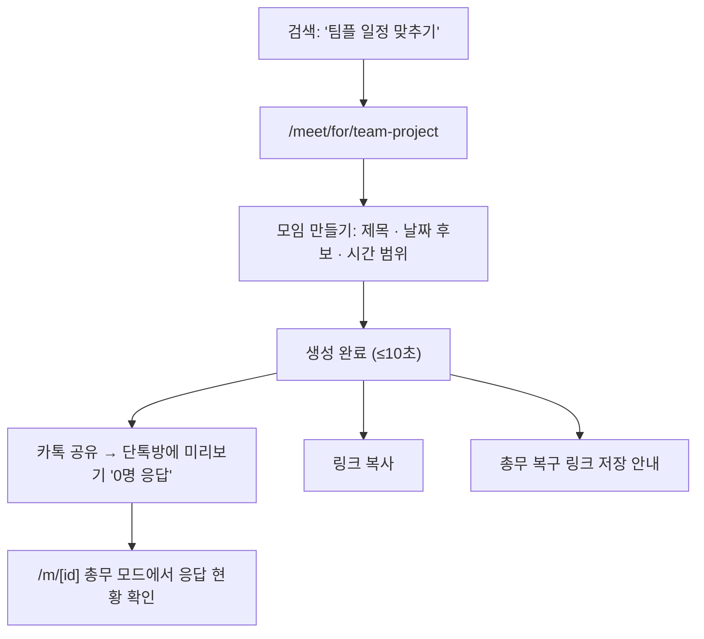
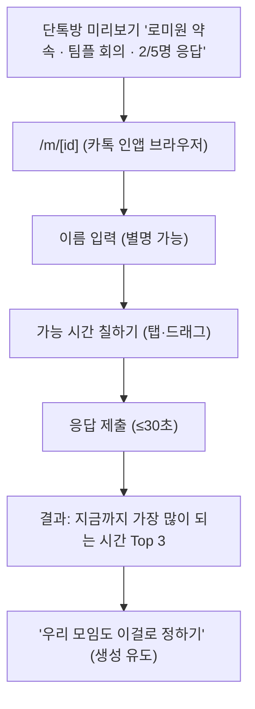

# [Lomeone] 서비스 마스터 PRD — 로미원 전체 서비스 기획서

| 항목 | 내용 |
| --- | --- |
| 제품 | **로미원 (Lomeone)** — 단톡방 총무를 위한 링크형 모임 도구 |
| 도메인 | lomeone.com |
| 문서 ID | `LM-PRD-00` |
| 문서 종류 | 서비스 마스터 PRD (최상위 기획서) |
| 버전 | v1.1 |
| 작성일 | 2026-10-28 (v1.1 2026-10-29) |
| 범위 | 서비스 전체 (1단계 약속잡기 → 4단계 글로벌, 24개월) |
| 독자 | 창업자, 웹디자이너, 프론트엔드/풀스택 개발자, AI 코딩 에이전트 |
| 원본 | Claude Docs "로미원(Lomeone) — 서비스 메인 기획서 v0.2" |
| 하위 문서 | `LM-PRD-01` MVP 웹디자인 기획서 (`lomeone-01-mvp-web-design-prd.md`) 외 §19 목록 |
| 상태 | 확정 초안 — 🔴 표시 항목은 해당 기능 착수 전 결정 필요 (§18) |

> **이 문서를 읽는 법**
>
> - 이 문서는 로미원이라는 **서비스 전체의 설계도**다. "누구를 위해, 어떤 도구를, 어떤 순서로, 어떤 기준을 넘으면 성공이라고 부르는가"를 정의한다.
> - 화면·컴포넌트·디자인 상세는 하위 문서 `LM-PRD-01`이 담당한다. 충돌하면 **범위·원칙·성공 기준은 이 문서, 화면 상세는 하위 문서**가 우선한다.
> - **디자이너는** §1(원칙), §2(브랜드), §3(사용자), §6(IA), §7(여정)을 본 뒤 `LM-PRD-01`로 넘어간다.
> - **개발자는** §8(기능 명세), §9(비기능), §10(데이터·아키텍처)를 먼저 본다.
> - ID 체계: 기능 `F-xx` · 요구사항 `R-xx-n` · 수용 기준 `AC-xx-n` · 성공 기준 `SC-xx` · 가설 `H-n` · 결정 `D-x`. 화면 `SCR-xx`·컴포넌트 `C-xx`는 `LM-PRD-01`에서 정의한다.

---

## 0. 용어

| 용어 | 정의 |
| --- | --- |
| 총무 | 모임 링크를 만드는 사람. 핵심 고객이자 성장 엔진 |
| 참여자 | 총무가 공유한 링크로 들어와 응답하는 사람. 트래픽이자 다음 총무 후보 |
| 모임 (Meet) | 약속잡기로 만든 하나의 일정 조율 단위. 제목·날짜 후보·시간 범위를 가진다 |
| 슬롯 | 30분 단위 시간 칸. 응답의 최소 단위 |
| 응답 | 참여자 1명이 고른 가능 슬롯의 묶음 |
| 확정 | 총무가 최종 시간을 정한 상태 |
| 총무 키 | 총무 권한을 증명하는 비밀 토큰. 로그인 대신 사용 |
| 도구 | 로미원 브랜드 아래의 개별 기능 (약속·사다리·팀 나누기·돌림판·자리배치·롤링페이퍼) |
| 전환 | 참여자가 30일 안에 직접 모임 링크를 만드는 것 |

---

## 1. 서비스 개요

### 1.1 한 문장 정의

**단톡방 총무가 링크 하나로 약속 시간 정하기·사다리·팀 나누기·롤링페이퍼를 끝내는, 로그인 없는 웹 도구.** 목표는 24개월 안에 MAU 100만이며, 운영자가 만드는 콘텐츠 없이 1인+AI로 운영한다.

### 1.2 서비스 구조

```
┌──────────────────────────────────────────────────────────────┐
│  브랜드: Lomeone (로미원)  — lomeone.com                         │
├──────────────┬──────────────┬──────────────┬─────────────────┤
│ 로미원 약속   │ 로미원 사다리 │ 로미원 팀나누기│ 로미원 롤링페이퍼 │
│ /meet  [1단계]│ /ladder[2단계]│ /teams [2단계]│ /paper  [3단계]  │
│              │ 돌림판 /wheel │ 자리배치 /seats│                 │
└──────────────┴──────────────┴──────────────┴─────────────────┘
          모든 도구의 공통점: 총무가 만들고 → 링크로 공유 → 여러 명이 쓴다
```

- 사용자의 대부분은 로미원을 찾아오지 않는다. **친구가 단톡방에 올린 링크를 눌러 처음 만나거나, "약속 잡기" 같은 검색으로 도구 페이지에 들어온다.** 모든 설계는 이 두 입구를 기준으로 한다.

### 1.3 해결하는 문제

| # | 문제 | 지금의 대안과 한계 | 로미원의 답 |
| --- | --- | --- | --- |
| P1 | 모임 하나 잡을 때마다 단톡방에 "언제 돼?"가 수십 개 오간다 | 단톡방에서 직접 물어보기 — 정리가 안 됨 | 가능 시간을 칠하면 최적 시간이 자동으로 나옴 |
| P2 | 카카오톡 투표는 후보를 총무가 미리 정해야 한다 | 카톡 투표·일정 | 후보 없이 가능 시간만 모으면 교집합 계산 |
| P3 | 해외 도구는 모바일에서 불편하고 한국 단톡방에 안 맞는다 | when2meet — 오래된 UI, 카톡 미리보기 없음 | 모바일 드래그 UX, 카톡 공유 최적화, 확정까지 한 흐름 |
| P4 | 가입·설치를 요구하는 도구는 참여자가 응답하지 않는다 | 일정 관리 앱, 구글폼 | 참여자는 이름만 쓰고 30초 안에 끝 |

### 1.4 제품 원칙 (모든 기획·디자인·개발 판단의 기준)

| # | 원칙 | 의미 | 위반 예시 (하지 말 것) |
| --- | --- | --- | --- |
| PR-1 | **생성 10초, 응답 30초, 로그인 0회** | 총무는 10초 안에 링크를 만들고, 참여자는 30초 안에 응답한다 | 생성 전 회원가입, 응답 전 휴대폰 인증 |
| PR-2 | **참여자 경험이 곧 광고다** | 참여자 화면이 쾌적해야 다음 총무가 된다 | 응답 화면 광고, 앱 설치 배너, 가입 유도 팝업 |
| PR-3 | **콘텐츠는 사용자가 넣는다** | 운영자가 매일 만들어야 하는 콘텐츠가 있는 기능은 만들지 않는다 | 데일리 퀴즈, 큐레이션 피드 |
| PR-4 | **링크는 비공개다** | 모임 페이지는 링크를 아는 사람만 본다. 공개 목록·검색 노출 없음 | 공개 모임 피드, 모임 페이지 색인 |
| PR-5 | **최소 수집, 자동 삭제** | 이름(별명 가능)과 가능 시간만 저장하고 기한이 지나면 지운다 | 전화번호·이메일 필수 입력 |
| PR-6 | **카톡 미리보기가 첫 화면이다** | 단톡방에 뜨는 미리보기 이미지·제목이 첫인상이다 | 모든 링크에 같은 정적 썸네일 |
| PR-7 | **한 화면 한 가지 일** | 각 화면은 하나의 행동만 요구한다 | 응답 화면에 장소·투표·채팅을 한꺼번에 |
| PR-8 | **혼자 자는 동안에도 안 죽는다** | 서버 직접 운영 0, 관리형 서비스, 자동 알림·차단 | 수동 배포, 수동 스팸 처리 |

---

## 2. 브랜드와 이름 (확정 2026-10-28)

### 2.1 결정

- 서비스 이름: **Lomeone (로미원)** · 도메인: **lomeone.com**
- 구조: **뜻이 비어 있는 브랜드 + 기능 이름.** 카카오(브랜드) + 톡(기능)과 같은 방식.

| 층 | 이름 | 역할 |
| --- | --- | --- |
| 브랜드 | Lomeone (로미원) | 도메인, 신뢰, 재방문 |
| 기능 | 로미원 약속 / 로미원 사다리 / 로미원 팀나누기 / 로미원 돌림판 / 로미원 자리배치 / 로미원 롤링페이퍼 | 무엇을 하는지 바로 전달 |
| 주소 | lomeone.com/meet, /ladder, /teams, /wheel, /seats, /paper | 기능별 검색 페이지 |

### 2.2 결정 이유

1. **도구 묶음이라서.** "약속○○" 같은 설명형 이름은 2단계(사다리·팀 나누기)에서 맞지 않게 된다. when2meet·wheelofnames처럼 설명형 이름은 도구가 하나일 때만 유리하다.
2. **소유할 수 있어서.** 일반 명사는 상표로 지키기 어렵고 경쟁 서비스와 구분되지 않는다.
3. **입구가 이름이 아니라서.** 사용자는 친구의 링크(친구를 믿고 누름)나 검색 결과의 기능 페이지로 들어온다.
4. **moyemap.com을 쓰지 않는 이유:** 이미 로테이션 소개팅·혼술바·솔로파티 정보 사이트로 쓰고 있어, 팀플·회사 단톡방에 링크로 뜨면 공유를 꺼리게 된다. "map"은 지도 서비스를 기대하게 만든다. moyemap은 기존 용도로 분리해 둔다.

### 2.3 표기 규칙

| 항목 | 규칙 | 예 |
| --- | --- | --- |
| 한글 표기 | **"로미원" 하나만** 쓴다 (로메원·로미온 금지) | 로미원 |
| 영문 표기 | 본문·로고 소문자 `lomeone`, 문장 첫머리·법적 문서는 `Lomeone` | lomeone.com |
| 병기 | 로고·카톡 미리보기·OG 이미지에는 한글과 영문을 항상 같이 | 로미원 lomeone |
| 기능명 | "로미원 + 기능" 띄어 쓴다 | 로미원 약속 |
| 미리보기 제목 | 기능을 먼저, 상태를 뒤에 | "로미원 약속 · 수요일 19시 확정" |

- 읽는 법 근거: lo-me-one은 썸원(someone)·에브리원(everyone)과 같은 리듬이라 대부분 "로미원"으로 읽는다.
- **브랜드 색·로고 (D-5, 확정 2026-10-29):** 민트 틸 `#0B7F70` + 겹친 두 원 심볼 (두 원이 겹친 자리 = 모두 되는 시간). 확정 카드는 브랜드 색 꽉 채움. 상세 토큰은 `cowork/design/` 시안과 `LM-DS-90`(예정).
- 🔴 D-1a: "Lomeone" 상표 검색(KIPRIS), 오타 도메인(romione.com, lomiwon.com) 구매 가능 여부 확인 후 lomeone.com으로 301 연결.

---

## 3. 타깃 사용자

### 3.1 세그먼트

| 세그먼트 | 모임 예시 | 주기 | 한 모임 인원 | 우선순위 |
| --- | --- | --- | --- | --- |
| 대학생 | 팀플, 동아리, 스터디 | 학기 중 주 1회 이상 | 4~30명 | 1순위 (시드) |
| 직장인 | 회식, 회의, 스터디 | 월 1~4회 | 4~20명 | 2순위 |
| 친구·동창 | 여행, 송년회, 동창회 | 분기 1회, 연말 급증 | 4~50명 | 2순위 |
| 교사·강사 | 상담·학부모 일정 / 사다리·팀 나누기 | 학기 중 수시 | 20~30명 | 3순위 (2단계 도구) |

인원과 주기는 가정이며 MVP 로그로 검증한다.

### 3.2 페르소나

| 페르소나 | 상황 | 유입 | 원하는 한 가지 | 핵심 화면 |
| --- | --- | --- | --- | --- |
| **지원 (22, 대학 3학년)** | 팀플 조장. 5명 단톡방에서 회의 시간 정하기 | "팀플 일정 맞추기" 검색 | 다음 주 저녁 중 전원 되는 시간 | 모임 만들기 → 결과 |
| **민수 (24, 동아리 회장)** | 30명 동아리 정기 모임 | 지원의 링크로 처음 참여 | 다음 모임도 이걸로 빠르게 | 참여 → "나도 만들기" |
| **서연 (29, 회사 3년차)** | 팀 회식 담당, 8명 | 동료가 쓴 링크 | 팀장님 일정 우선 반영 | 결과 → 확정 → 캘린더 |
| **현우 (35, 고교 동창회 총무)** | 연말 동창회 40명 | "약속 잡기" 검색 | 날짜 후보 여러 개 중 최다 인원 날 | 날짜만 모드 → 결과 |

### 3.3 사용자 과업 (Jobs To Be Done)

1. **J1** 여러 사람의 가능한 시간을 빨리 모으고 싶다. → 모임 만들기 + 공유
2. **J2** 링크를 받았을 때 귀찮지 않게 내 시간을 알려주고 싶다. → 응답
3. **J3** 모두가 되는 시간을 계산 없이 보고 싶다. → 결과·추천
4. **J4** 정한 시간을 모두에게 알리고 잊지 않게 하고 싶다. → 확정·캘린더
5. **J5** (2단계~) 모임에서 공정하게 정하고 나누고 싶다. → 사다리·팀 나누기·돌림판

---

## 4. 목표와 성공 기준

### 4.1 사업 목표

| 목표 | 시점 | 값 |
| --- | --- | --- |
| MAU | 24개월차 | **1,000,000** |
| 월간 생성 모임 수 (North Star) | 24개월차 | 약 20만 개 (MAU ÷ 참여 7명 ÷ 중복 보정 0.7) |
| 운영 인원 | 전 기간 | 1인 + AI |
| 수익화 시작 | MAU 30만 이후 | 광고 → 총무 프로 |

### 4.2 단계별 게이트

**규칙: 게이트를 통과하지 못하면 다음 단계로 가지 않는다. 범위를 늘리는 대신 접는다.**

| 단계 | 기간 | 핵심 산출물 | 게이트 (통과 기준) |
| --- | --- | --- | --- |
| G1 약속잡기 MVP | 0~2개월 | P0 기능 7개 공개 출시, 대학생 시드 | 링크당 응답 5명+ · 참여→생성 전환 8%+ (실패 시 랜덤 도구로 웨지 교체) |
| G2 랜덤 도구 | 3~6개월 | 사다리·팀 나누기·돌림판·자리배치, 도구별 검색 랜딩 | MAU 3만 · 직접유입 30%+ |
| G3 시즌 부스터 | 6~12개월 | 롤링페이퍼(졸업 2월·스승의날 5월·연말 12월), 반복 모임, 장소 투표 | MAU 15만 → 광고 수익화 검토 |
| G4 글로벌 + 수익화 | 12~24개월 | 영어·일본어, 광고 → 총무 프로 | MAU 100만 |

### 4.3 검증 가설과 킬 기준 (출시 8주 뒤 판정)

| 가설 | 지표 | 목표 | 킬 기준 |
| --- | --- | --- | --- |
| H-1 링크가 사람을 데려온다 | 링크당 응답자 수 | 5명 이상 | 3명 미만 |
| H-2 참여자가 총무가 된다 | 30일 내 참여자 → 생성자 전환율 | 8% 이상 | 3% 미만 |
| H-3 총무가 다시 온다 | 생성자 4주 내 재생성률 | 40% 이상 | 15% 미만 |
| H-4 만든 링크는 실제로 공유된다 | 응답 1명 이상 받은 링크 비율 | 80% 이상 | 50% 미만 |
| H-5 끝까지 쓴다 | 확정까지 간 링크 비율 | 50% 이상 | 20% 미만 |

**판정 규칙:** H-1·H-2 중 하나라도 킬 기준에 걸리면 약속잡기를 웨지로 쓰지 않고, 랜덤 도구(사다리·돌림판)를 웨지로 바꿔 같은 표로 다시 잰다. H-2가 MAU 결과를 가장 크게 좌우한다 (§11).

### 4.4 서비스 Success Criteria (품질 수준)

출시 판단(§17)과 QA는 이 표를 기준으로 한다.

| ID | 영역 | 성공 기준 | 측정 방법 | 통과 값 | 적용 |
| --- | --- | --- | --- | --- | --- |
| SC-01 | 사용성 | 랜딩 진입 → 모임 링크 생성 완료 | `meet_created.ms_from_start` 중앙값 | ≤ 10초 (사내 5명), 실사용 ≤ 30초 | 1단계~ |
| SC-02 | 사용성 | 링크 진입 → 응답 제출 | `response_submitted.ms_from_view` 중앙값 | ≤ 30초 | 1단계~ |
| SC-03 | 사용성 | 링크 진입자 중 응답 제출 비율 | `response_submitted ÷ meet_viewed(참여자)` | ≥ 70% | 1단계~ |
| SC-04 | 속도 | 모임 페이지 모바일 LCP | CrUX p75 / Lighthouse | ≤ 2.0초 | 1단계~ |
| SC-05 | 속도 | 슬롯 칠하기 반응 | INP p75 | ≤ 100ms | 1단계~ |
| SC-06 | 속도 | 응답 제출 → 결과 반영 | 서버 응답 p95 | ≤ 500ms | 1단계~ |
| SC-07 | 공유 | 카톡 미리보기에 제목·응답 현황 표시 | 카카오 공유 디버거 + 실기기 | 상태 4종 모두 정상 | 1단계~ |
| SC-08 | 호환 | 카카오톡·네이버 인앱 브라우저에서 전 흐름 완료 | 실기기 테스트 (iOS·Android) | 오류 0건 | 1단계~ |
| SC-09 | 개인정보 | 저장 항목이 이름·가능 시간·모임 정보로 한정 | 스키마 리뷰 | 그 외 개인정보 0 | 1단계~ |
| SC-10 | 개인정보 | 보관 기한 지난 모임 자동 삭제 | 삭제 작업 로그 | 기한 + 1일 이내 삭제 | 1단계~ |
| SC-11 | 보안 | 모임 ID 추측·열거 불가 | ID 생성 방식 리뷰 + 열거 시도 차단 | 무작위 10자 이상, rate limit 동작 | 1단계~ |
| SC-12 | 보안 | 총무 키 없이 수정·확정·삭제 불가 | E2E | 0건 | 1단계~ |
| SC-13 | 접근성 | WCAG 2.2 AA | axe + 키보드·스크린리더 수동 점검 | 심각·중대 위반 0 | 전 단계 |
| SC-14 | SEO | 도구 랜딩 페이지 기술 SEO | Lighthouse SEO | 100 | 전 단계 |
| SC-15 | SEO | 모임 페이지 비색인 | `noindex` + robots 점검 | 색인 0건 | 전 단계 |
| SC-16 | 운영 | 장애 → 알림 | 모니터링 | 5분 이내 알림 | 전 단계 |

---

## 5. 범위와 단계별 릴리스

### 5.1 기능 × 단계 매트릭스

✅ 포함 · ➖ 제외 · ⬆ 확장 · P0 출시 필수 / P1 출시 후 4주 / P2 보류

| 영역 | 기능 ID | 1단계 (0~2개월) | 2단계 (3~6개월) | 3단계 (6~12개월) | 4단계 (12~24개월) |
| --- | --- | --- | --- | --- | --- |
| 모임 만들기 | F-01 | ✅ P0 | ✅ | ✅ | ✅ |
| 카톡 공유·동적 미리보기 | F-02 | ✅ P0 | ✅ | ✅ | ⬆ 해외 메신저 |
| 응답 (슬롯 칠하기) | F-03 | ✅ P0 | ✅ | ✅ | ✅ |
| 결과·추천 | F-04 | ✅ P0 | ✅ | ✅ | ✅ |
| 확정·캘린더 추가 | F-05 | ✅ P0 | ✅ | ✅ | ✅ |
| 생성 유도·내 모임 | F-06 | ✅ P0 | ✅ | ✅ | ✅ |
| 장소 투표 | F-07 | P1 | ✅ | ✅ | ✅ |
| 응답 마감·리마인드 문구 | F-08 | P1 | ✅ | ✅ | ✅ |
| 반복 모임 | F-09 | P1 | ✅ | ✅ | ✅ |
| 사다리 타기 | F-10 | ➖ | ✅ | ✅ | ✅ |
| 팀 나누기 | F-11 | ➖ | ✅ | ✅ | ✅ |
| 돌림판 | F-12 | ➖ | ✅ | ✅ | ✅ |
| 자리배치 | F-13 | ➖ | ✅ | ✅ | ✅ |
| 롤링페이퍼 | F-14 | ➖ | ➖ | ✅ | ✅ |
| 다국어 (영어·일본어) | F-15 | ➖ (구조만 대비) | ➖ | ➖ | ✅ |
| 광고 | F-16 | ➖ | ➖ | 검토 (MAU 30만~) | ✅ |
| 총무 프로 | F-17 | ➖ | ➖ | ➖ | ✅ (MAU 50만~) |
| 회원 계정 | F-18 | P2 | P2 | 검토 | 검토 |
| 계측 | F-19 | ✅ P0 | ✅ | ✅ | ✅ |
| 신뢰·법적 고지·악용 방지 | F-20 | ✅ P0 | ✅ | ⬆ 롤링페이퍼 신고 | ✅ |
| 도구별 검색 랜딩 | F-21 | ✅ P0 (약속) | ⬆ 도구 4종 | ⬆ 롤링페이퍼 | ⬆ 다국어 |

### 5.2 영구 비목표 (어떤 단계에서도 하지 않는다)

- 공개 피드·공개 모임 목록·사용자 간 검색 (PR-4, 모더레이션 부담).
- 운영자가 매일 만들어야 하는 콘텐츠 (PR-3).
- 채팅·댓글 스레드 (카카오톡이 이미 한다).
- 네이티브 앱 (입구가 100% 링크·웹 검색). PWA는 3단계 이후 검토 가능.
- 응답자 화면 광고 (PR-2).

---

## 6. 정보 구조 (IA)

### 6.1 사이트맵

`[1]` 1단계 · `[2]` 2단계 · `[3]` 3단계 · `[4]` 4단계

```
/                                    [1]  홈 — 도구 소개, 약속잡기 바로 시작
├─ /meet                             [1]  로미원 약속 랜딩 (검색 착지 + 바로 만들기)
│  ├─ /meet/new                      [1]  모임 만들기
│  └─ /meet/for/[usecase]            [1]  용도별 랜딩 (team-project, club, dinner, reunion …)
├─ /m/[meetId]                       [1]  모임 페이지 (응답 / 결과 / 확정 — 상태에 따라)
│     ?k=[adminKey]                       총무 복구 링크 (최초 1회 저장 후 URL에서 제거)
├─ /my                               [1]  내 모임 (이 기기에 저장된 목록)
├─ /ladder  /teams  /wheel  /seats   [2]  랜덤 도구 4종 (각각 랜딩 겸 도구)
│  └─ /r/[resultId]                  [2]  도구 결과 공유 링크
├─ /paper                            [3]  로미원 롤링페이퍼 랜딩
│  ├─ /paper/new                     [3]  롤링페이퍼 만들기
│  └─ /p/[paperId]                   [3]  롤링페이퍼 (작성 / 받는 사람 보기)
├─ /about                            [1]  로미원 소개
├─ /legal/privacy                    [1]  개인정보처리방침
├─ /legal/terms                      [1]  이용약관
├─ /404, /gone                       [1]  없음 / 기한 만료·삭제된 모임
└─ /en/..., /ja/...                  [4]  다국어
```

### 6.2 URL·라우팅 규칙

- 슬러그는 영문 소문자 케밥케이스, 화면 문구는 한국어. 한국어는 접두사 없이 루트, 4단계 다국어는 `/en`, `/ja`.
- **모임 ID**: 무작위 base62 10자 (예: `/m/7Gx2kQp9Za`). 순번·날짜 등 추측 가능한 정보 금지.
- **총무 키**: 무작위 base62 22자. 생성 직후 이 기기의 localStorage에 저장. "총무 복구 링크"(`/m/[id]?k=...`)를 한 번 보여주고 복사하게 한다. 키가 URL에 붙어 들어오면 저장 후 즉시 주소창에서 제거한다.
- 모임 페이지(`/m/*`, `/r/*`, `/p/*`)는 전부 `noindex, nofollow`. 검색 유입은 도구 랜딩 페이지만 받는다.

### 6.3 글로벌 내비게이션

| 영역 | 내용 |
| --- | --- |
| 헤더 좌측 | 로고 (→ `/`) |
| 헤더 우측 | 1단계: "내 모임" · "만들기". 2단계~: 도구 메뉴(약속·사다리·팀나누기·돌림판·자리배치) |
| 모임 페이지 | 헤더 축소 (로고만). 참여자가 할 일 하나에 집중 (PR-7) |
| 푸터 | 도구 링크 · 로미원 소개 · 개인정보처리방침 · 이용약관 · 문의 이메일 |

---

## 7. 핵심 사용자 여정

### 7.1 여정 A — 총무: 검색 → 링크 생성 → 공유



### 7.2 여정 B — 참여자: 링크 → 응답 → 결과



### 7.3 여정 C — 확정

```
총무가 결과 화면에서 추천 1위 "수 19:00–21:00 · 5/5명" 선택
 → [이 시간으로 확정] → 확정 카드 생성
 → "단톡방에 알리기" (카톡 공유: 미리보기가 '확정' 상태로 바뀜)
 → 참여자: 확정 카드에서 [캘린더에 추가] (.ics / 구글 캘린더)
```

### 7.4 여정 D — 참여자가 총무가 되는 순간 (성장 루프의 핵심)

```
민수는 지원의 팀플 링크에 응답했다
 → 결과 화면 하단 "우리 모임도 이걸로 정하기" 카드
 → 탭하면 /meet/new 로 이동, 이름이 미리 채워짐
 → 동아리 모임 링크 생성 → 30명 단톡방에 공유
```

- 생성 유도 카드는 **응답을 제출한 뒤에만** 보인다 (응답 전에는 할 일 하나: PR-7).

---

## 8. 기능 명세

각 기능은 **목적 → 요구사항(R) → 상태·예외 → 수용 기준(AC) → 디자인·개발 노트** 순서다. 화면 상세는 `LM-PRD-01`.

### F-01 모임 만들기 `[1단계 P0]`

**목적:** 총무가 10초 안에 공유할 링크를 갖는다.

| ID | 요구사항 |
| --- | --- |
| R-01-1 | 입력은 3가지: ① 모임 이름(선택, 기본값 "우리 모임", 최대 40자) ② 날짜 후보 ③ 시간 범위 |
| R-01-2 | 날짜 후보 선택 방식 2가지: "날짜로" (달력에서 여러 날 탭) / "요일로" (월~일 중 선택, 반복 모임용) |
| R-01-3 | 날짜 후보: 최소 1일, 최대 31일. 기본 선택 = 없음, 오늘부터 14일이 첫 화면에 보인다 |
| R-01-4 | 시간 범위: 시작·종료 (30분 단위), 기본 오전 9시~오후 10시. "날짜만 정하기"(종일) 옵션 |
| R-01-5 | 로그인 없이 생성. 생성 즉시 모임 ID와 총무 키 발급 (§6.2) |
| R-01-6 | 생성 후 바로 공유 화면으로 이동 (F-02) |
| R-01-7 | 시간대는 생성 기기의 시간대(기본 Asia/Seoul)로 저장 |
| R-01-8 | (P1) 응답 마감 시각, 참여 인원 예상(미리보기 "3/5명"용) |

**상태·예외:** 날짜 0개 → 만들기 버튼 비활성 + "날짜를 하나 이상 골라 주세요". 종료 ≤ 시작 → "끝나는 시간은 시작보다 늦어야 해요". 네트워크 실패 → 입력값 유지 + "다시 시도".

**수용 기준**
- [ ] AC-01-1 랜딩 → 생성 완료 중앙값 10초 이내 (사내 테스트 5명, SC-01).
- [ ] AC-01-2 기본값만으로 날짜 1개 탭 + 만들기 = 2번 탭으로 생성 가능.
- [ ] AC-01-3 360px 폭에서 스크롤 없이 만들기 버튼이 보인다 (날짜 14일 노출 상태).

### F-02 카톡 공유·동적 미리보기 `[1단계 P0]`

**목적:** 단톡방에 뜨는 미리보기가 첫 화면이다 (PR-6).

| ID | 요구사항 |
| --- | --- |
| R-02-1 | 공유 수단: ① 카카오톡 공유(카카오 JS SDK 메시지 템플릿) ② 링크 복사 ③ Web Share API(지원 시) |
| R-02-2 | 링크마다 동적 OG 이미지(1200×630) 생성: 모임 이름 + 상태 문구 + 로미원 로고 |
| R-02-3 | OG 상태 4종: 응답 0명 "가능한 시간을 알려주세요" / 응답 중 "3명 응답" / 확정 "수요일 19:00 확정" / 만료 "종료된 모임" |
| R-02-4 | OG title 형식: "로미원 약속 · {모임 이름}", description: 상태 문구 |
| R-02-5 | 카카오 공유 버튼 문구: "가능한 시간 알려주기" (참여자 행동 기준) |
| R-02-6 | 카카오 SDK가 실패해도 링크 복사만으로 미리보기가 뜬다 (OG 태그 기본) |

**수용 기준:** AC-02-1 4개 상태 모두 카카오톡(iOS·Android) 미리보기 정상 (SC-07). AC-02-2 OG 이미지 생성 p95 ≤ 1초, 캐시 적용.

**개발 노트:** 카카오톡은 OG 이미지를 캐시하므로 상태가 바뀌면 이미지 URL에 버전 파라미터(`?v=응답수`)를 바꿔 새로 긁게 한다. 카카오 디벨로퍼스 앱 등록·도메인 등록 필요 (D-4).

### F-03 응답 (슬롯 칠하기) `[1단계 P0]`

**목적:** 참여자는 30초 안에 응답을 끝낸다 (PR-1).

| ID | 요구사항 |
| --- | --- |
| R-03-1 | 첫 진입: 모임 이름·날짜 범위·응답자 수 + 이름 입력 1개 (최대 20자). 같은 모임에 이미 있는 이름이면 덮어쓰지 않고 막는다: "이미 있는 이름이에요. 이름 뒤에 글자를 붙이거나 별명을 써 주세요" (v1.1) |
| R-03-2 | 슬롯 그리드: 가로 = 날짜, 세로 = 30분 슬롯. 탭 = 한 칸 토글, 누른 채 드래그 = 연속 칠하기(시작 칸 상태 기준으로 칠하기/지우기) |
| R-03-3 | 모바일 360px에서 한 화면에 날짜 최대 5열. 그 이상은 가로 넘김(좌우 화살표 + 스와이프), 날짜 헤더·시간축 고정 |
| R-03-4 | "전부 가능" / "이 날 전부" 빠른 선택 |
| R-03-5 | 칠하는 동안 다른 사람 응답이 옅게 겹쳐 보이는 "다른 사람 보기" 토글 (기본 꺼짐) |
| R-03-6 | 제출 후 이 기기에 응답자 토큰 저장 → 재방문 시 바로 "내 응답 수정" 가능 |
| R-03-7 | 응답 수정은 **응답한 기기에서만** 가능하다 (응답자 토큰). 다른 기기·브라우저에서는 새 이름으로 응답한다. PIN은 보류(D-6) (v1.1) |
| R-03-9 | 총무는 응답을 삭제할 수 있다 (응답자 칩 또는 응답자 목록 → 삭제 → 확인 시트). 잘못 들어간 응답·장난 응답 처리용 (v1.1) |
| R-03-8 | 날짜만 모드: 그리드 대신 날짜 카드 목록 + 가능/애매/불가 3단계 선택 |

**상태·예외:** 선택 0칸 제출 → "가능한 시간이 없어요"로 제출 허용(결과에 "불가"로 표시). 확정된 모임 → 응답 대신 확정 카드 표시 + "응답 수정은 총무에게 요청하세요". 만료 → `/gone`.

**수용 기준**
- [ ] AC-03-1 링크 진입 → 제출 중앙값 30초 이내 (SC-02).
- [ ] AC-03-2 iOS Safari·Android Chrome·카톡 인앱에서 드래그 칠하기 중 페이지가 스크롤되지 않는다 (SC-08).
- [ ] AC-03-3 칠하기 반응 INP ≤ 100ms (SC-05).

### F-04 결과·추천 `[1단계 P0]`

**목적:** 모두가 되는 시간을 계산 없이 본다 (J3).

| ID | 요구사항 |
| --- | --- |
| R-04-1 | 히트맵: 슬롯마다 가능 인원에 따라 6단계 농도(0명 ~ 전원 직전). 전원 가능 슬롯은 별도 강조(테두리 + 아이콘, 색만으로 구분 금지) |
| R-04-2 | 추천 Top 3: 가능 인원 많은 순 → 연속 길이 긴 순 → 이른 날짜 순. 연속 슬롯은 하나로 묶어 "수 19:00–21:00 · 5/5명". 순위 번호는 인원 기준 공동 순위(1·1·3), 카드는 최대 3개, 공동 1위는 모두 강조 (v1.1) |
| R-04-3 | 추천 카드 탭 → 그 시간에 안 되는 사람 이름 표시 ("민수 빠짐") |
| R-04-4 | 응답자 목록: 이름 + 응답 시각. 탭하면 그 사람 응답만 하이라이트 |
| R-04-5 | 최소 시간 필터: [30분 이상 \| 1시간 이상 \| 2시간 이상], 기본 1시간. 1시간 이상 겹치는 구간이 없으면 자동으로 30분 + 안내 문구. 날짜만 모드에선 숨김 (v1.1) |
| R-04-6 | (P1) 필수 참석자 지정: 총무가 "이 사람은 꼭" 체크 → 그 사람 가능 시간 안에서만 추천 |
| R-04-7 | 결과는 응답 1명 이상부터 공개. 모든 참여자가 볼 수 있다. 응답자 이름은 공개한다 (익명 옵션은 출시 후 요청 시 P2 검토) |
| R-04-8 | **날짜만 모드 결과:** 점수 = 돼요 1 + 애매 0.5, 동률은 돼요 수 → 이른 날짜. 추천 카드 "11/8 (토) · 돼요 5 · 애매 2" + 날짜순 가로 막대 목록 (v1.1) |
| R-04-9 | **요일 모드 결과:** 헤더는 요일만, 추천 "매주 수 19:00–21:00" (v1.1) |

**수용 기준:** AC-04-1 추천 알고리즘 단위 테스트 (동률·연속 구간·빈 응답 케이스 12건). AC-04-2 응답 제출 후 결과 반영 ≤ 500ms (SC-06).

### F-05 확정·캘린더 추가 `[1단계 P0]`

| ID | 요구사항 |
| --- | --- |
| R-05-1 | 총무만 확정 가능 (총무 키). 추천 카드 또는 그리드에서 시간 선택 → [이 시간으로 확정] |
| R-05-2 | 확정 시 모임 페이지 최상단이 확정 카드로 바뀐다: 모임 이름, 날짜·시간, 참석 가능 인원, (P1) 장소 |
| R-05-3 | [단톡방에 알리기]: 카톡 공유 (미리보기 상태 "확정") |
| R-05-4 | [캘린더에 추가]: .ics 다운로드, 구글 캘린더 링크. (iOS는 .ics로 기본 캘린더 연결) |
| R-05-5 | 총무 ⋯ 메뉴: **확정 시간 바꾸기**(결과 화면에서 새 시간 확정 → 확정 카드 "시간이 바뀌었어요 (이전: …)" + "바뀐 시간 알리기", 미리보기 제목 "… · 시간 변경") / **확정 취소**(응답 받는 중으로 복귀, 미리보기도 "응답 중", 토스트로 단톡방 알리기 제안) (v1.1) |
| R-05-6 | 날짜만 모드 확정: 시간은 선택 입력, 기본 "하루 종일". 요일 모드 확정: "매주 수요일 오후 7:00 – 9:00", 캘린더는 매주 반복 일정(.ics RRULE) (v1.1) |

**수용 기준:** AC-05-1 확정 → 카톡 미리보기 상태 변경 확인 (SC-07). AC-05-2 .ics 파일이 iOS 캘린더·구글 캘린더·삼성 캘린더에서 올바른 시간대로 열린다.

### F-06 생성 유도·내 모임 `[1단계 P0]`

**목적:** 참여자를 다음 총무로 만든다 (H-2).

| ID | 요구사항 |
| --- | --- |
| R-06-1 | 응답 제출 후 결과 화면 하단에 생성 유도 카드: "우리 모임도 이걸로 정하기" |
| R-06-2 | 카드 탭 → `/meet/new`로 이동, 출처 기록 (`source=respondent`) |
| R-06-3 | 확정 카드 아래에도 같은 카드 (확정 직후는 다음 모임을 떠올리는 순간) |
| R-06-4 | `/my`: 이 기기에서 만든 모임·응답한 모임 목록 (localStorage). 상태 배지(응답 중·확정·만료) |
| R-06-5 | 총무 복구 링크 안내: 생성 직후 1회 + `/my`에서 다시 보기. "이 링크가 있으면 다른 기기에서도 관리할 수 있어요". 저장 수단: 복사 + **"카톡 '나와의 채팅'에 저장"**(로그인 없는 일반 카카오 공유로 총무 링크를 보내고 받는 곳으로 나와의 채팅을 고르게 안내. 메시지 제목 "🔑 총무 전용 링크 · 단톡방에 올리지 마세요") (v1.1) |
| R-06-7 | 총무 키가 없는 기기에서 모임을 연 총무를 위해 결과 화면 맨 아래 "총무 링크로 열기"(링크 붙여넣기 → 키 저장) (v1.1) |
| R-06-6 | 문구·위치 A/B 테스트 가능 구조 (문구 키 분리, 위치 prop) |

**수용 기준:** AC-06-1 응답 → 생성 유도 카드 노출률 100% (응답 제출 세션 기준). AC-06-2 `meet_created.source` 에 `respondent` 기록.

### F-07 ~ F-09 1단계 P1 (출시 후 4주)

| ID | 기능 | 요약 |
| --- | --- | --- |
| F-07 | 장소 투표 | 총무가 장소 후보 추가 (이름 + 지도 링크), 참여자 복수 선택, 결과에 득표 수. 확정 카드에 장소 표시 |
| F-08 | 응답 마감·리마인드 문구 | 마감 시각 설정, 마감 후 응답 잠금. 미응답 독려 문구 복사 ("아직 3명 남았어요! 👉 링크") — 이름을 모르므로 개별 알림은 없음 |
| F-09 | 반복 모임 | "다음 회차 만들기": 같은 이름·요일·시간 범위로 새 모임 복제, 지난 응답자 이름 목록 유지 |

### F-10 ~ F-13 랜덤 도구 `[2단계]`

| ID | 도구 | 핵심 | 공유 |
| --- | --- | --- | --- |
| F-10 | 사다리 타기 | 참가자·결과 입력 → 애니메이션 → 결과표 | 결과 링크 `/r/[id]` (조작 불가 증명: 생성 시각·시드 표시) |
| F-11 | 팀 나누기 | 이름 목록 → 팀 수 또는 팀당 인원 → 무작위 배정, 고정 인원 옵션 | 결과 링크 |
| F-12 | 돌림판 | 항목 입력 → 돌리기, 당첨 제외 후 다시 돌리기 | 결과 링크, 방송 화면용 큰 화면 모드 |
| F-13 | 자리배치 | 교실·회의실 격자 → 무작위 배치, 고정석 | 결과 링크, 인쇄용 |

- 공통: 입력은 붙여넣기 지원 (줄바꿈·쉼표 구분), 모임 페이지의 응답자 이름을 그대로 가져오기 ("이 모임 사람들로 팀 나누기").
- 상세는 `LM-PRD-20`(예정).

### F-14 롤링페이퍼 `[3단계]`

총무가 받는 사람 이름으로 롤링페이퍼 생성 → 링크 공유 → 참여자가 메시지 작성(익명/실명 선택) → 공개일에 받는 사람이 열람. 시즌: 졸업(2월), 스승의날(5월), 연말(12월). **악용 대응 필수:** 신고 버튼, 신고 2건 시 자동 숨김, 욕설 필터, 작성 rate limit. 상세는 `LM-PRD-30`(예정).

### F-15 다국어 `[4단계]`

모든 UI 문구는 MVP부터 `copy/{locale}.ts`에 모은다. 날짜·시간 표기, 요일 시작(월/일), 시간대 자동 보정. 공유 수단: LINE(일본), WhatsApp·iMessage(영어권).

### F-16 광고 `[3~4단계]`

조건: MAU 30만 이후. 총무 화면(결과·관리)과 도구 랜딩에만. **응답자 화면 금지 (PR-2).** 성능 예산(LCP·CLS) 유지.

### F-17 총무 프로 `[4단계]`

반복 모임 무제한, 50명 이상 대규모, 엑셀 내보내기, 광고 제거, 사용자 지정 링크. 가격 미정 (D-7).

### F-18 회원 계정 `[P2]`

로그인 없는 흐름(PR-1)을 해치지 않을 때만. 목적은 "내 모임" 기기 간 동기화. 3단계에서 재검토.

### F-19 계측 `[1단계 P0]`

- 쿠키 없는 분석(Plausible 등) + 서버 이벤트 로그. 이름·시간 원값 전송 금지.
- 이벤트: `landing_viewed{page}`, `meet_create_started{source}`, `meet_created{source, dates, mode, ms_from_start}`, `share_clicked{method}`, `admin_link_copied`, `meet_viewed{role}`, `response_started`, `response_submitted{slots, ms_from_view}`, `result_viewed`, `recommend_tapped{rank}`, `meet_confirmed{respondents}`, `calendar_added{type}`, `create_cta_shown{place}`, `create_cta_clicked{place}`.
- 핵심 퍼널: 랜딩 → 생성 → 공유 → 첫 응답 → 응답 5명 → 확정. 성장 퍼널: 응답 제출 → 생성 유도 노출 → 클릭 → 생성 (H-2).

### F-20 신뢰·법적 고지·악용 방지 `[1단계 P0]`

- 개인정보처리방침: 수집 항목(이름·가능 시간·모임 정보·접속 로그), 목적, 보관 기간, 삭제 방법.
- 보관 기간: 마지막 날짜 후보 또는 확정일 + 90일 후 자동 삭제 (🔴 D-3 법률 검토 후 확정). 총무는 언제든 [모임 삭제].
- 악용 방지: 생성·응답 rate limit (IP·기기 기준), 모임 이름·후보 장소에 외부 링크 입력 제한(피싱 방지), 모임 ID 열거 탐지 차단, 신고 메일.
- 연령: 만 14세 미만 개인정보 처리 이슈 → 이름은 별명 허용, 실명 요구 안 함 (D-3에 포함).

### F-21 도구별 검색 랜딩 `[1단계 P0 약속] ⬆`

- `/meet` + 용도별 `/meet/for/[usecase]` 6개로 시작: 팀플(team-project), 동아리(club), 회식(dinner), 동창회(reunion), 스터디(study), 여행(trip).
- 각 페이지: 용도 맞춤 H1("팀플 회의 시간, 링크 하나로 맞추세요") + 바로 만들기 폼(첫 화면) + 3단계 사용법 + FAQ 3~5개 + 다른 도구 링크.
- 용도별 페이지는 **기본값만 다르다** (예: 회식 = 저녁 6~10시, 동창회 = 날짜만 모드). 템플릿을 찍어낸 얇은 페이지 금지 — 2026년 3월 구글 업데이트 이후 대량 생성 페이지는 순위가 떨어진다.
- 네이버 서치어드바이저·구글 서치콘솔 등록, JSON-LD `WebApplication` + `FAQPage`.

---

## 9. 비기능 요구사항

### 9.1 성능 예산

| 지표 | 도구 랜딩 | 모임 페이지 |
| --- | --- | --- |
| LCP (모바일 4G, p75) | ≤ 2.0s | ≤ 2.0s |
| CLS | ≤ 0.05 | ≤ 0.1 |
| INP | ≤ 200ms | ≤ 100ms (칠하기) |
| 초기 JS (gzip) | ≤ 100KB | ≤ 150KB |

### 9.2 개인정보·보안

| 항목 | 요구사항 |
| --- | --- |
| 수집 | 이름(별명), 가능 시간, 모임 정보, 서버 접속 로그. 그 외 없음 (SC-09) |
| 권한 | 총무 키·응답자 토큰은 해시로 저장. 키 없이 수정·확정·삭제 불가 (SC-12) |
| 삭제 | 보관 기한 자동 삭제 (SC-10), 총무 수동 삭제 즉시 |
| 전송 | HTTPS·HSTS, 보안 헤더(CSP·Referrer-Policy: strict-origin-when-cross-origin — 모임 URL이 외부로 새지 않게) |
| 관리자 | 운영자 화면에서 개별 모임 내용을 열람하는 기능을 만들지 않는다 (통계만) |

### 9.3 브라우저·기기 지원

| 대상 | 지원 |
| --- | --- |
| **카카오톡 인앱 브라우저 (iOS·Android)** | **최우선.** 참여자 유입의 대부분. 전 흐름 실기기 테스트 필수 |
| 네이버 앱·인스타그램 인앱 | 지원 |
| 모바일 | iOS Safari, Android Chrome, 삼성 인터넷 최근 2개 메이저 |
| 데스크톱 | Chrome·Edge·Safari·Firefox 최근 2개 |
| 최소 폭 | 320px (설계 기준 360px) |

### 9.4 접근성

WCAG 2.2 AA. 슬롯 그리드는 키보드(방향키 이동·스페이스 토글·Shift+방향키 범위 선택)와 스크린리더("수요일 오후 7시, 가능, 3명 중 2명") 지원. 히트맵은 색 + 숫자·패턴 병행.

### 9.5 운영

- 서버 직접 운영 0. 관리형 호스팅 + 관리형 DB (PR-8).
- 모니터링: 오류 추적(Sentry 등), 가동 감시, 비용 상한 알림, 트래픽 급증 알림 (SC-16).
- 배포: main 브랜치 자동 배포, 미리보기 배포로 QA.

---

## 10. 데이터·아키텍처 개요

### 10.1 원칙

1. **서버는 얇게.** 모임 생성·응답 저장·OG 이미지 생성만 서버에서. 추천 계산은 클라이언트에서도 같은 함수로 (공유 패키지).
2. **로그인 대신 토큰.** 총무 키·응답자 토큰으로 권한 판별.
3. **삭제가 기본.** 모든 모임 레코드는 `expires_at`을 가진다.

### 10.2 시스템 구성 (제안, 🔴 D-2)

```
┌──────────── 브라우저 ────────────┐       ┌──────────── 서버 (관리형) ──────────────┐
│ Next.js (도구 랜딩 SSG)          │       │ API: 모임 생성·조회·응답·확정·삭제        │
│ 모임 페이지 (CSR + 실시간 갱신)  │──────▶│ DB: meets, slots, responses, places     │
│ 추천 계산 (공유 함수)            │       │ OG 이미지 생성 (엣지, 캐시)              │
│ localStorage: 총무 키, 내 모임   │       │ 만료 삭제 작업 (일 1회)                  │
└──────────────────────────────────┘       │ rate limit · 봇 차단                    │
   분석 · 오류 추적                         └─────────────────────────────────────────┘
```

**결정 (D-2, 2026-10-29): 프론트 = Next.js + Vercel, 백엔드 = 별도 서버로 구현.** 백엔드 언어·DB·호스팅은 `LM-PRD-02`에서 정한다. 기준: 100만 MAU에서 월 비용, OG 이미지 생성(프론트 엣지 또는 백엔드), 실시간 갱신.

### 10.3 핵심 데이터 모델

| 엔티티 | 핵심 필드 |
| --- | --- |
| Meet | id(10자), title, mode(`datetime` \| `date_only`), dates[] 또는 weekdays[], time_start, time_end, slot_minutes(30), timezone, deadline?, confirmed_slot?, admin_key_hash, created_at, expires_at |
| Response | id, meet_id, name, slots[](비트맵 또는 슬롯 인덱스 배열), responder_token_hash, created_at, updated_at |
| Place (P1) | id, meet_id, name, map_url, votes[] |
| ToolResult (2단계) | id, tool(`ladder` \| `teams` \| `wheel` \| `seats`), input, seed, result, created_at, expires_at |
| Paper (3단계) | id, recipient_name, open_at, messages[], report_count |

---

## 11. 성장 모델

### 11.1 성장 루프

```
총무가 링크 생성 ─▶ 단톡방에 공유 ─▶ 참여자 응답 (링크당 평균 7명, 가정)
       ▲                                        │
       └──── 일부가 다음 모임의 총무로 (30일 내 전환 8%, 가정) ◀┘
   + 시드: 검색 SEO · 대학 커뮤니티
```

- 한 달 뒤 총무 수 ≈ 지난달 총무 × (유지 60% + 7명 × 전환 8%) = **월 1.16배**. 전환이 5%로 떨어지면 0.95배로, 시드 없이는 줄어든다.
- MAU ≈ 월 생성 모임 수 × 참여 7명 × 중복 보정 0.7.

### 11.2 시뮬레이션 (2026-10-27, 가정: 링크당 7명, 총무 월 유지 60%, 시드 월 300~3,000명, 중복 30% 제외)

| 개월 | MAU (전환 8%) | MAU (전환 5%) |
| --- | --- | --- |
| 3 | 5,153 | 4,193 |
| 6 | 33,809 | 24,560 |
| 9 | 78,539 | 42,023 |
| 12 | 148,358 | 56,996 |
| 15 | 283,104 | 90,798 |
| 18 | 493,429 | 119,780 |
| 21 | 821,723 | 144,628 |
| 24 | 1,334,157 | 165,932 |

**결론:** 전환율 3%p 차이가 24개월 MAU를 8배 바꾼다. MVP의 첫 검증 대상은 사용자 수가 아니라 **참여자 → 총무 전환율(H-2)**이다. 시드는 루프가 돌기 전까지 버티는 연료일 뿐이다.

### 11.3 근거 (시장)

| 서비스 | 형태 | 트래픽 | 직접유입 | 비고 |
| --- | --- | --- | --- | --- |
| wheelofnames | 돌림판 하나 | 월 2,266만 방문 | 48.5% | 평균 체류 11분 |
| remove.bg | 배경 제거 | 월 1.06억 방문 | 50.9% | |
| Monkeytype | 타이핑 테스트 | 월 2천만+ 방문 | 약 67% | 1인 운영 |
| when2meet | 일정 조율 링크 | 약 612만 | — | UI 수년간 그대로 |
| 내 트리를 꾸며줘 | 링크 공유 메시지 | 트리 250만 개, 메시지 3,600만 | — | 2021.12, 7인 팀 |

트래픽은 Semrush 2026년 9월 추정치. 한국 검색 점유율: 네이버 48.6%, 구글 42.9% → 두 곳 모두 SEO.

---

## 12. 경쟁과 차별화

가장 큰 경쟁자는 카카오톡 안의 투표와 "그냥 단톡방에서 물어보기"다. 이기는 방법은 기능 수가 아니라 **단톡방에서 물어보는 것보다 빠르다**는 느낌이다.

| 대안 | 강점 | 약점 | 로미원이 이기는 지점 |
| --- | --- | --- | --- |
| 카카오톡 투표·일정 | 앱 안에 있음, 설치 0 | 후보를 총무가 미리 골라야 함, 교집합 계산 없음 | 가능 시간을 칠하면 최적 시간 자동 |
| when2meet | 인지도, 무료, 교집합 계산 | 모바일 UI 불편, 카톡 미리보기 없음, 확정·캘린더 없음 | 모바일 드래그 UX, 한국어, 확정까지 한 흐름 |
| 국내 when2meet 클론 | 한국어 | 완성도·인지도 낮음 | 완성도 + SEO + 도구 묶음 |
| 구글폼·네이버폼 | 범용 | 일정 조율용 아님, 만드는 데 수 분 | 생성 10초 |
| 네이버 검색창 사다리 등 (2단계) | 검색 결과 맨 위 | 저장·공유·재사용 없음 | 결과를 링크로 공유, 모임에 연결 |

**방어 수단:** ① 브랜드 회상("약속 잡기" 하면 떠오르는 이름, 직접유입 50% 목표) ② 도구 묶음(같은 총무가 한 곳에서) ③ 누적 데이터(반복 모임 멤버·패턴).

---

## 13. 수익 모델 (후순위)

MAU 30만 전에는 수익화하지 않는다. 성장 루프를 해치는 수익 수단은 쓰지 않는다.

1. **광고 (MAU 30만~):** 총무 결과 화면과 도구 랜딩에만. 응답자 화면 금지. 한국 CPC가 미국의 약 1/6이라 글로벌 트래픽이 커진 뒤에야 의미가 있다.
2. **총무 프로 (MAU 50만~):** 반복 모임 무제한, 50명 이상, 엑셀 내보내기, 광고 제거, 사용자 지정 링크. 가격 미정 (D-7).
3. **단체용 (후순위):** 학교·동아리연합·기업 행사용 상담·면접 일정 조율.

---

## 14. 법적·규제 요약

| 항목 | 내용 | 단계 |
| --- | --- | --- |
| 개인정보보호법 | 수집 최소화, 처리방침 게시, 보관 기간·파기, 만 14세 미만 처리 기준 (🔴 D-3) | 1단계 |
| 정보통신망법 | 이용약관, 신고 처리 절차 (롤링페이퍼 3단계에서 강화) | 1단계~ |
| 상표 | "Lomeone" 상표 검색·출원 검토 (🔴 D-1a) | 1단계 |
| 카카오 플랫폼 정책 | 카카오 공유 API 이용 약관·메시지 템플릿 정책 준수 | 1단계 |
| 해외 (4단계) | GDPR(EU·영국), 일본 개인정보보호법 | 4단계 |

---

## 15. 로드맵

| 기간 | 단계 | 핵심 산출물 | 게이트 | 하위 PRD |
| --- | --- | --- | --- | --- |
| 1주차 | 준비 | D-1a·D-2·D-3·D-4 결정, 디자인 착수 | — | `LM-PRD-01` |
| 2~3주차 | 개발 | P0 기능 7개, 지인 모임 10개로 비공개 테스트 | SC 전부 통과 | `LM-PRD-01`, `LM-PRD-02`(예정) |
| 4주차 | 공개 출시 | 대학 커뮤니티·단톡방 시드 | — | |
| 5~8주차 | P1 | 장소 투표·마감·반복 모임 | — | |
| 10주차 | G1 판정 | KPI 표로 계속 / 웨지 교체 | H-1·H-2 | |
| 3~6개월 | G2 | 랜덤 도구 4종 + 랜딩 | MAU 3만 · 직접유입 30% | `LM-PRD-20`(예정) |
| 6~12개월 | G3 | 롤링페이퍼, 시즌 캠페인 | MAU 15만 | `LM-PRD-30`(예정) |
| 12~24개월 | G4 | 영어·일본어, 광고, 총무 프로 | MAU 100만 | `LM-PRD-40`, `-60`(예정) |

**축소 규칙 (1인 번아웃 방어):** 일정이 밀리면 범위를 접는다. 접는 순서: 반복 모임 → 장소 투표 → 용도별 랜딩 개수. **줄이지 않는 것:** 생성 10초·응답 30초, 카톡 인앱 호환, 개인정보 원칙.

---

## 16. 리스크와 대응

| 리스크 | 강도 | 대응 | 관련 |
| --- | --- | --- | --- |
| 참여자 → 총무 전환이 낮음 | 높음 | 결과·확정 화면 생성 유도 A/B, 노출 위치 실험. 3% 미만이면 웨지 교체 | H-2 |
| 카카오톡이 비슷한 기능 추가 | 높음 | 도구 묶음·브랜드로 분산, 일본·영어권 조기 확장 | — |
| 카카오 공유 API 정책·심사 변경 | 중간 | 링크 복사만으로도 미리보기가 뜨도록 OG 태그 기본 | F-02 |
| 학기·연말 계절성 | 중간 | 직장인·친구 모임 비중 확대, 방학엔 롤링페이퍼·여행 일정 | — |
| 스팸·악용 (피싱 링크, 악성 롤링페이퍼) | 중간 | rate limit, 외부 링크 입력 제한, 신고 + 자동 숨김 | F-20 |
| 트래픽 급증으로 비용·장애 | 중간 | 서버리스·엣지 캐시, 비용 상한 알림, 부하 테스트 | SC-16 |
| 1인 번아웃 | 중간 | 게이트·축소 규칙 | §15 |

---

## 17. 출시 판단 기준 (Definition of Launch)

| 단계 | 필수 통과 |
| --- | --- |
| 1단계 공개 | SC-01~16 · 개인정보처리방침·이용약관 게시 · 카카오 앱 등록·도메인 검증 · 분석 퍼널(H-1~H-5) 설정 · 404/만료 화면 · 디자인 QA(`LM-PRD-01` §13) |
| 2단계 | 1단계 항목 + 도구별 결과 링크 noindex · 붙여넣기 입력 검수 |
| 3단계 | 2단계 항목 + 롤링페이퍼 신고·숨김·욕설 필터 · 정보통신망법 신고 절차 |
| 4단계 | 3단계 항목 + 국가별 법적 고지 · hreflang · 로케일 날짜·시간 검수 |

---

## 18. 결정 필요 · 열린 질문

| ID | 질문 | 막는 것 | 기본안 | 상태 |
| --- | --- | --- | --- | --- |
| D-1 | 서비스명·도메인 | 전부 | **Lomeone (로미원) · lomeone.com** | ✅ 확정 2026-10-28 |
| 🔴 D-1a | 상표 검색, 오타 도메인(romione.com, lomiwon.com) | 출시 | KIPRIS 검색 후 출원 검토, 오타 도메인은 구매 가능 시 301 | 미결 |
| D-2 | 기술 스택 | 개발 착수 | **프론트 Next.js + Vercel, 백엔드 별도 구현** (백엔드 세부는 LM-PRD-02) | ✅ 확정 2026-10-29 |
| 🔴 D-3 | 보관 기간, 만 14세 미만 처리 | 출시 | 마지막 날짜 + 90일 자동 삭제, 실명 요구 안 함 | 법률 검토 필요 |
| 🔴 D-4 | 카카오 디벨로퍼스 앱 등록·메시지 템플릿 | 공유 기능 | 1주차 등록 | 미결 |
| D-5 | 브랜드 색·폰트·로고 | 전 화면 시안 | **민트 틸 #0B7F70 + 겹친 두 원 + Pretendard, 확정 카드 꽉 채움** | ✅ 확정 2026-10-29 |
| D-6 | 응답 수정 보호 (PIN) | 응답 | 1단계는 기기 토큰으로만 수정 + 총무 응답 삭제(R-03-7·R-03-9). PIN은 출시 후 악용 시 검토 | 출시 후 판단 |
| D-7 | 총무 프로 가격 | 4단계 | 미정 | 4단계 전 |

---

## 19. 문서 체계 (prd 디렉토리)

| 파일 | 문서 ID | 내용 | 상태 |
| --- | --- | --- | --- |
| `README.md` | — | 디렉토리 안내·파일명 규칙·문서 목록 | ✅ |
| `lomeone-00-service-master-prd.md` | LM-PRD-00 | **이 문서.** 서비스 전체 기획 | ✅ v1.0 |
| `lomeone-01-mvp-web-design-prd.md` | LM-PRD-01 | 1단계 웹디자인 기획서: 화면 SCR·컴포넌트 C·디자인 요구사항 | ✅ v1.0 |
| `lomeone-02-mvp-dev-prd.md` | LM-PRD-02 | 1단계 개발 명세: API·DB 스키마·추천 알고리즘·유저 스토리 | 예정 (D-2 후) |
| `lomeone-20-random-tools-prd.md` | LM-PRD-20 | 사다리·팀 나누기·돌림판·자리배치 | 예정 (3개월차) |
| `lomeone-30-rolling-paper-prd.md` | LM-PRD-30 | 롤링페이퍼·신고·필터 | 예정 (6개월차) |
| `lomeone-40-monetization-prd.md` | LM-PRD-40 | 광고·총무 프로 | 예정 |
| `lomeone-60-global-prd.md` | LM-PRD-60 | 영어·일본어 | 예정 (12개월차) |
| `lomeone-90-design-system-spec.md` | LM-DS-90 | 디자인 토큰 확정값·시안 링크 | 예정 (디자인 확정 시) |

---

## 20. 변경 이력

| 버전 | 날짜 | 변경 |
| --- | --- | --- |
| v1.1 | 2026-10-29 | 디자인 시안 1차 질문(QUESTIONS.md) 답변 반영: 브랜드 확정(D-5), 스택 확정(D-2), 응답 수정은 기기에서만 + 총무 응답 삭제(R-03-1·7·9), 공동 순위·필터(R-04-2·5), 날짜만·요일 모드 결과·확정(R-04-8·9, R-05-6), 확정 변경·취소 흐름(R-05-5), 총무 링크 저장·열기(R-06-5·7) |
| v1.0 | 2026-10-28 | 최초 작성. Claude Docs 메인 기획서 v0.2(아이템 리서치 v3, 브랜드 결정 포함)를 서비스 마스터 PRD 형식으로 정리 |

> MAU·전환율 등 모든 수치는 명시된 가정에 기반한 추정이며 출시 후 실측으로 갱신한다.
