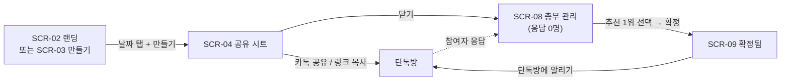
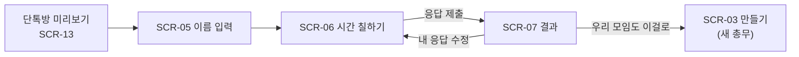

# [Lomeone] 1단계 웹디자인 기획서 — 로미원 약속 (MVP)

| 항목 | 내용 |
| --- | --- |
| 제품 | **로미원 (Lomeone)** · lomeone.com |
| 문서 ID | `LM-PRD-01` |
| 문서 종류 | 단계별 PRD — 1단계 웹디자인 기획서 |
| 버전 | v1.0 |
| 작성일 | 2026-10-28 |
| 범위 | 1단계 "로미원 약속" 출시에 필요한 모든 화면·컴포넌트·디자인 시스템·브랜드 자산 |
| 독자 | **웹디자이너** (1차), 프론트엔드 개발자, 창업자 |
| 상위 문서 | `LM-PRD-00` 서비스 마스터 PRD (`lomeone-00-service-master-prd.md`) |
| 상태 | 디자인 착수용 확정본 — 🔴 표시는 디자인 중 결정 필요 (§14) |

> **이 문서를 읽는 법**
>
> - 이 문서는 디자이너가 **추가 질문 없이 1단계 웹사이트 전체를 디자인할 수 있도록** 화면·상태·문구·컴포넌트·디자인 제약을 정의한다.
> - **무엇을, 왜, 어떤 상태까지**는 이 문서가 정한다. **어떻게 보이는지(색·형태·일러스트·레이아웃 세부)**는 디자이너가 정한다. 이 문서의 와이어프레임은 정보 배치의 기준일 뿐 시각 디자인이 아니다.
> - 먼저 §1(디자인 목표)·§2(브랜드)·§3(사용 맥락)을 읽고, §5(핵심 흐름) → §6(화면별 명세) → §8(컴포넌트) 순서로 작업한다.
> - 화면은 `SCR-xx`, 컴포넌트는 `C-xx`, 디자인 수용 기준은 `DAC-xx`. 디자인 파일(Figma)의 페이지·프레임·컴포넌트 이름에 이 ID를 붙인다 (예: `SCR-06 응답 / 기본`).
> - 상위 원칙 `PR-1~8`은 `LM-PRD-00` §1.4.

---

## 1. 디자인 목표와 성공 기준

### 1.1 한 줄 목표

**단톡방에서 링크를 누른 사람이, 처음 보는 사이트인데도 30초 안에 망설임 없이 응답하고, "다음엔 나도 이걸로 해야지"라고 느끼게 한다.**

### 1.2 디자인이 지켜야 할 5가지

| # | 원칙 | 디자인에서의 의미 |
| --- | --- | --- |
| DP-1 | **처음 보는 사람도 바로 안다** | 참여자는 로미원을 모른다. 첫 화면에서 "무엇을 해달라는지"가 한 문장으로 보여야 한다 |
| DP-2 | **엄지 하나로 끝난다** | 모든 핵심 행동은 한 손 엄지로, 화면 아래쪽 절반에서 할 수 있어야 한다 |
| DP-3 | **할 일은 한 화면에 하나** | 응답 화면에서는 응답만, 결과 화면에서는 결과만 (PR-7) |
| DP-4 | **결과는 계산 없이 읽힌다** | 히트맵을 해석하지 않아도 "수요일 7시, 5명 전원"이 글자로 보인다 |
| DP-5 | **단톡방에 올리고 싶은 모습** | 미리보기 이미지·확정 카드는 공유하고 싶을 만큼 깔끔해야 한다. 업무툴처럼 딱딱하지도, 파티 앱처럼 들뜨지도 않게 |

### 1.3 디자인 수용 기준 (DAC)

시안 확정 전 아래를 모두 통과해야 한다. 검증 방법은 §13.

| ID | 기준 | 통과 값 |
| --- | --- | --- |
| DAC-01 | 360×640 첫 화면에서 각 화면의 주 버튼이 스크롤 없이 보인다 | SCR-02·03·04·05·07·09 전부 |
| DAC-02 | 프로토타입으로 처음 쓰는 사람 5명이 모임 생성 | 중앙값 10초 이내, 도움 없이 5/5명 성공 |
| DAC-03 | 프로토타입으로 처음 쓰는 사람 5명이 응답 제출 | 중앙값 30초 이내, 5/5명 성공 |
| DAC-04 | 결과 화면을 본 사람에게 "언제가 제일 좋아요?" 질문 | 5/5명이 5초 안에 정답 |
| DAC-05 | 색 대비 | 본문 4.5:1, 큰 글자·UI 경계 3:1 이상 (WCAG 2.2 AA) |
| DAC-06 | 색각 이상 시뮬레이션(제1·2색맹)에서 히트맵 단계·전원 가능 표시 구분 | 구분 가능 |
| DAC-07 | 모든 컴포넌트가 §7.8 상태 체크리스트를 갖춘다 | 누락 0 |
| DAC-08 | 시안의 모든 문구가 최종 문구다 (§10) | Lorem ipsum·임시 문구 0 |
| DAC-09 | 카카오톡 미리보기 4종(§6 SCR-13)이 실제 카톡 화면 크기에서 읽힌다 | 모임 이름·상태 판독 가능 |
| DAC-10 | 로고 심볼이 16px 파비콘과 카톡 썸네일 크기에서 식별된다 | 식별 가능 |

---

## 2. 브랜드 방향

### 2.1 브랜드 요약

| 항목 | 내용 |
| --- | --- |
| 이름 | **로미원** (한글은 이 표기 하나만) / **lomeone** (영문, 로고·본문 소문자) |
| 구조 | 브랜드 + 기능: "로미원 약속", 2단계부터 "로미원 사다리", "로미원 팀나누기" … |
| 한 줄 소개 | 모임의 귀찮은 일을 링크 하나로 |
| 1단계 기능 소개 | 로미원 약속 — 가능한 시간만 칠하면, 모두 되는 시간이 나와요 |

### 2.2 성격과 톤

| 축 | 방향 | 피할 것 |
| --- | --- | --- |
| 성격 | 눈치 빠른 친구 같은 총무. 가볍고 빠르지만 정돈돼 있다 | 사내 업무툴의 딱딱함, 관공서 서식 느낌 |
| 시각 무드 | 밝고 여백 많음. 색은 적게, 하나의 브랜드 색이 행동을 이끈다 | 네온·그라데이션 과다, 과한 3D·캐릭터 일러스트 |
| 연상 금지 | 데이팅·파티·술자리 연상 (같은 창업자의 moyemap과 분리) | 하트, 와인잔, 밤 분위기 배경 |
| 문구 톤 | 해요체, 짧게, 행동을 말한다 ("가능한 시간을 칠해 주세요") | 명령조, 과장("완벽한"), 이모지 남발 |
| 감정 | 귀찮음을 덜어주는 홀가분함 | 재촉·압박 ("아직도 응답 안 했어요?") |

무드 키워드 (디자이너 참고): **가벼움 · 정돈 · 친근 · 빠름 · 신뢰**

### 2.3 로고 요구사항 (디자이너 제안 2안, 🔴 D-5)

| 항목 | 요구 |
| --- | --- |
| 구성 | ① 심볼 ② 영문 워드마크 `lomeone` ③ 한글 워드마크 `로미원` ④ 조합형 (심볼 + 영문 + 한글) |
| 크기 대응 | 16px 파비콘, 32px 탭 아이콘, 180px 홈 화면 아이콘, 카톡 미리보기 썸네일 안 로고 |
| 버전 | 컬러 / 단색(검정·흰색) / 다크 배경용 |
| 의미 (선택) | 강제 아님. 참고 방향: 여러 사람이 모이는 모양, 시간 칸이 채워지는 모양, `o` 두 개 |
| 피할 것 | 달력·시계 아이콘을 그대로 쓴 심볼 (2단계 도구로 확장할 때 맞지 않음) |
| 확장성 | 2단계 "로미원 사다리·팀나누기·돌림판·자리배치"에서도 같은 심볼을 쓴다 |

### 2.4 기능 아이콘 체계

1단계는 "약속" 하나지만, 2단계 도구 4종과 3단계 롤링페이퍼가 같은 아이콘 체계에 들어가도록 **기능 아이콘 6종의 스타일 원칙**을 함께 제안한다 (1단계 시안에는 약속 아이콘만 쓴다): 약속 · 사다리 · 팀나누기 · 돌림판 · 자리배치 · 롤링페이퍼.

---

## 3. 사용자와 사용 맥락

### 3.1 두 종류의 사용자

| | 총무 | 참여자 |
| --- | --- | --- |
| 누구 | 모임 링크를 만드는 사람 (1명) | 링크를 받고 응답하는 사람 (평균 7명) |
| 들어오는 길 | 검색 ("약속 잡기", "팀플 일정 맞추기"), 다른 모임에서 참여해 본 경험 | **카카오톡 단톡방의 링크 미리보기** |
| 첫 화면 | SCR-02 랜딩 / SCR-03 만들기 | SCR-05 모임 페이지 (이름 입력) |
| 아는 것 | 로미원을 찾아서 왔다 | 로미원을 **모른다**. 친구를 믿고 눌렀을 뿐 |
| 원하는 것 | 10초 만에 링크 만들고 단톡방에 던지기 | 30초 만에 응답하고 나가기 |
| 다음 행동 | 결과 확인 → 확정 → 알리기 | (일부) 다음 모임에서 총무가 되기 |

### 3.2 기기와 환경 (디자인 우선순위)

| 우선순위 | 환경 | 비고 |
| --- | --- | --- |
| 1 | **모바일, 카카오톡 인앱 브라우저** (iOS·Android) | 참여자의 대부분. 상단에 카톡 브라우저 바, 하단에 카톡 툴바가 겹친다 → 실제 보이는 높이는 약 560~600px |
| 2 | 모바일 Safari·Chrome·삼성 인터넷 | 검색으로 온 총무 |
| 3 | 데스크톱 1280px | 회사에서 회식·회의 잡는 총무, 교사 |

- 설계 기준 폭 **360px**, 최소 **320px**까지 깨지지 않는다.
- 인앱 브라우저 하단 툴바를 감안해 **하단 고정 버튼 영역은 safe-area 여백 포함**으로 디자인한다.

---

## 4. 정보 구조와 화면 목록

### 4.1 1단계 사이트맵

```
/                         SCR-01 홈
├─ /meet                  SCR-02 로미원 약속 랜딩 (검색 착지 + 바로 만들기)
│  ├─ /meet/new           SCR-03 모임 만들기
│  └─ /meet/for/[용도]     SCR-02 변형 (팀플·동아리·회식·동창회·스터디·여행 6종)
├─ /m/[모임ID]            SCR-05~09 모임 페이지 (보는 사람·상태에 따라 화면이 바뀜)
├─ /my                    SCR-10 내 모임
├─ /about                 SCR-12 소개
├─ /legal/privacy, /terms SCR-12 문서 템플릿
└─ /404, /gone            SCR-11 없음·만료
```

### 4.2 화면 목록

| ID | 화면 | URL | 누가 | 목적 | 주요 컴포넌트 |
| --- | --- | --- | --- | --- | --- |
| SCR-01 | 홈 | `/` | 검색·직접 방문 | 로미원이 뭔지 알리고 약속 만들기로 보냄 | C-01, C-27, C-28, C-02 |
| SCR-02 | 약속 랜딩 (+ 용도별 6종) | `/meet`, `/meet/for/*` | 검색 유입 총무 | 첫 화면에서 바로 만들기 시작 | C-29(MeetCreateForm), C-27, C-30 |
| SCR-03 | 모임 만들기 | `/meet/new` | 총무 | 10초 안에 생성 | C-29, C-05, C-06, C-07 |
| SCR-04 | 공유 시트 (생성 완료) | `/m/[id]` 위 시트 | 총무 | 단톡방에 공유, 총무 복구 링크 저장 | C-12, C-13 |
| SCR-05 | 모임 첫 진입 (이름 입력) | `/m/[id]` | 참여자 | 무엇을 해달라는지 알고 이름 입력 | C-23, C-04 |
| SCR-06 | 응답 (시간 칠하기) | `/m/[id]` | 참여자 | 가능 시간 칠하고 제출 | C-08, C-31 |
| SCR-06b | 응답 — 날짜만 모드 | `/m/[id]` | 참여자 | 날짜별 가능/애매/불가 | C-25 |
| SCR-07 | 결과 | `/m/[id]` | 참여자·총무 | 모두 되는 시간 읽기 | C-10, C-08(히트맵), C-11, C-18 |
| SCR-08 | 총무 관리 | `/m/[id]` (총무 키 있음) | 총무 | 응답 현황, 확정, 공유, 수정·삭제 | C-10, C-32, C-12 |
| SCR-09 | 확정됨 | `/m/[id]` | 모두 | 확정 시간 알림, 캘린더 추가 | C-16, C-17, C-18 |
| SCR-10 | 내 모임 | `/my` | 총무·참여자 | 이 기기의 모임 목록 | C-19, C-20 |
| SCR-11 | 없음·만료 | `/404`, `/gone` | 모두 | 막다른 길에서 새 모임으로 | C-20 |
| SCR-12 | 문서 템플릿 | `/about`, `/legal/*` | 모두 | 소개·법적 고지 | 본문 레이아웃 |
| SCR-13 | 카톡 미리보기 이미지 (OG) 4종 | (이미지) | 단톡방 | 단톡방 첫인상 | C-24 |
| SCR-14 | 카카오톡 공유 메시지 카드 | (카카오 템플릿) | 단톡방 | 공유 버튼으로 보낸 메시지 | C-24 변형 |

---

## 5. 핵심 흐름

### 5.1 총무 흐름 (생성 → 공유 → 확정)



### 5.2 참여자 흐름 (미리보기 → 응답 → 결과 → 다음 총무)



### 5.3 화면이 상태에 따라 바뀌는 규칙 (`/m/[id]` 한 주소)

| 보는 사람 \ 모임 상태 | 응답 받는 중 | 확정됨 | 만료·삭제 |
| --- | --- | --- | --- |
| 처음 온 참여자 | SCR-05 → SCR-06 | SCR-09 (응답 대신 확정 카드) | SCR-11 |
| 응답한 참여자 (이 기기) | SCR-07 (+ 내 응답 수정) | SCR-09 | SCR-11 |
| 총무 (총무 키 있음) | SCR-08 | SCR-09 + 관리 메뉴 | SCR-11 |

---

## 6. 화면별 명세

각 화면: **목적 → 와이어프레임(정보 배치 기준) → 구성 요소 → 상태 → 문구 → 수용 기준.** 와이어프레임의 박스·위치는 정보 순서의 기준이며 시각 디자인은 디자이너가 정한다.

---

### SCR-01 홈 `/`

**목적:** 로미원을 처음 본 사람이 "모임 도구구나"를 알고 약속 만들기로 간다.

```
모바일 360                                  데스크톱 1280
┌────────────────────────────┐   ┌──────────────────────────────────────────────┐
│ [로고]          내 모임 만들기│   │ [로고]                     내 모임   [만들기] │
├────────────────────────────┤   ├──────────────────────────────────────────────┤
│ 모임의 귀찮은 일,           │   │ 모임의 귀찮은 일,          ┌───────────────┐ │
│ 링크 하나로                 │   │ 링크 하나로                │ 시간 칠하기    │ │
│ 가능한 시간만 칠하면         │   │ 가능한 시간만 칠하면        │ 데모 애니메이션│ │
│ 모두 되는 시간이 나와요      │   │ 모두 되는 시간이 나와요     │ (히트맵 채워짐)│ │
│ ┌────────────────────────┐ │   │ [ 약속 잡기 시작 ]          └───────────────┘ │
│ │ 칠하기 데모 (자동 재생)  │ │   │ 로그인 없이 · 무료                             │
│ └────────────────────────┘ │   ├──────────────────────────────────────────────┤
│ [   약속 잡기 시작   ]      │   │ 이렇게 써요: ① 만들고 ② 단톡방에 ③ 정해짐      │
│ 로그인 없이 · 무료          │   ├──────────────────────────────────────────────┤
├────────────────────────────┤   │ 이런 모임에: 팀플 · 동아리 · 회식 · 동창회 …    │
│ 이렇게 써요 (3단계)         │   ├──────────────────────────────────────────────┤
│ 이런 모임에 (용도 칩 6개)    │   │ 곧 나와요: 사다리 · 팀나누기 · 돌림판 · 자리배치│
│ 곧 나와요 (도구 4종, 흐림)   │   ├──────────────────────────────────────────────┤
│ 푸터                        │   │ 푸터                                          │
└────────────────────────────┘   └──────────────────────────────────────────────┘
```

| 요소 | 명세 |
| --- | --- |
| 히어로 데모 | 슬롯 그리드가 3명 응답으로 채워지고 "수 19:00 · 3/3명"이 뜨는 짧은 루프 (CSS/로티, 4초 이내, 1회 재생 후 정지). `prefers-reduced-motion`이면 완성 상태 정지 이미지 |
| 주 버튼 | "약속 잡기 시작" → `/meet/new` |
| 용도 칩 | 6개 → `/meet/for/*` |
| 곧 나와요 | 2단계 도구 4종. 비활성 카드 + "준비 중" 배지. 클릭 불가 |

**수용 기준:** DAC-01 (주 버튼 첫 화면).

---

### SCR-02 로미원 약속 랜딩 `/meet` · 용도별 `/meet/for/[용도]`

**목적:** 검색으로 온 총무가 **랜딩 첫 화면에서 바로 만들기를 시작**한다 (페이지 이동 없이).

```
모바일 360
┌────────────────────────────┐
│ [로고]              내 모임 │
├────────────────────────────┤
│ 팀플 회의 시간,             │  H1 (용도별로 다름)
│ 링크 하나로 맞추세요         │
│ 가능한 시간만 칠하면 끝      │  서브 1줄
├────────────────────────────┤
│ ┌ 모임 만들기 폼 (C-29) ──┐ │  ← SCR-03과 같은 폼을 그대로 넣는다
│ │ 모임 이름 [팀플 회의   ] │ │     (용도별 기본값 프리필)
│ │ 날짜 고르기 (달력 2주)   │ │
│ │ 시간 09:00 ~ 22:00 ▾    │ │
│ │ [  링크 만들기  ]        │ │
│ └────────────────────────┘ │
├────────────────────────────┤
│ 이렇게 써요 ① ② ③           │  C-27
│ 자주 묻는 질문 (3~5개)       │  C-30
│ 다른 모임에도 (용도 칩)      │
│ 푸터                        │
└────────────────────────────┘
```

**용도별 기본값 (디자인은 같고 문구·기본값만 다름)**

| 용도 | URL | H1 | 기본 이름 | 기본 시간·모드 |
| --- | --- | --- | --- | --- |
| 기본 | `/meet` | 약속 시간, 링크 하나로 맞추세요 | 우리 모임 | 09:00–22:00 |
| 팀플 | `/meet/for/team-project` | 팀플 회의 시간, 링크 하나로 맞추세요 | 팀플 회의 | 09:00–23:00 |
| 동아리 | `/meet/for/club` | 동아리 모임 날짜, 한 번에 정하세요 | 동아리 모임 | 10:00–22:00 |
| 회식 | `/meet/for/dinner` | 회식 날짜, 눈치 보지 말고 정하세요 | 팀 회식 | 18:00–22:00 |
| 동창회 | `/meet/for/reunion` | 동창회 날짜, 제일 많이 오는 날로 | 동창회 | 날짜만 모드 |
| 스터디 | `/meet/for/study` | 스터디 시간, 매주 고정으로 맞추세요 | 스터디 | 요일 모드, 09:00–23:00 |
| 여행 | `/meet/for/trip` | 여행 날짜, 다 같이 되는 날로 | 여행 | 날짜만 모드 |

**수용 기준:** DAC-01 — 360×640에서 "링크 만들기" 버튼까지 첫 화면에 보인다 (달력은 2주 노출로 높이를 맞춘다).

---

### SCR-03 모임 만들기 `/meet/new`

**목적:** 기본값만으로 **날짜 1개 탭 + 만들기 = 탭 2번**에 생성 (PR-1, 생성 10초).

```
모바일 360
┌────────────────────────────┐
│ ←  약속 만들기              │
├────────────────────────────┤
│ 모임 이름                   │
│ [ 우리 모임              ]  │  C-04 (선택 입력)
│                             │
│ [ 날짜+시간 | 날짜만 ]       │  C-07 모드
│                             │
│ 언제 중에 고를까요?          │
│ [날짜로 | 요일로]            │  C-05 상단 토글
│  10월 28일 ~ 11월 10일  ‹ › │
│  월 화 수 목 금 토 일        │
│  ○  ○ (●) ●  ●  ○  ○        │  탭해서 여러 날 선택
│  ○  ○  ○  ○  ○  ○  ○        │  드래그로 연속 선택
│ 3일 선택됨                   │
│                             │
│ 몇 시 사이에?                │
│ [09:00 ▾] ~ [22:00 ▾]       │  C-06
│                             │
├────────────────────────────┤
│ [   링크 만들기   ]          │  하단 고정 (safe-area 포함)
└────────────────────────────┘
```

| 요소 | 명세 |
| --- | --- |
| 모임 이름 | 선택. 비우면 "우리 모임". 최대 40자, 카운터는 30자부터 표시 |
| 모드 | 날짜+시간(기본) / 날짜만. 날짜만이면 "몇 시 사이에?" 영역이 사라진다 |
| 날짜 고르기 | "날짜로": 오늘부터 2주가 첫 화면, ‹ › 로 2주씩 이동, 최대 31일 선택. 지난 날짜 비활성. "요일로": 월~일 7개 토글 (반복 모임용) |
| 선택 요약 | "3일 선택됨" / 요일 모드 "매주 화·목" |
| 시간 범위 | 30분 단위 선택. 기본 09:00–22:00. 자정 넘김은 1단계 미지원 ("끝나는 시간은 24:00까지 고를 수 있어요") |
| 만들기 버튼 | 날짜 0개면 비활성. 누르면 로딩 → SCR-04 |

**상태:** 기본(날짜 0개, 버튼 비활성) · 날짜 선택됨 · 31일 초과 시도(토스트 "날짜는 최대 31일까지 고를 수 있어요") · 시간 오류 · 생성 중 · 네트워크 실패(입력 유지 + 배너).

**데스크톱:** 가운데 정렬 폼 (최대 폭 560px), 달력은 한 달 전체 노출.

---

### SCR-04 공유 시트 (생성 완료)

**목적:** 만든 링크를 **곧바로 단톡방에 던지게** 하고, 총무 복구 링크를 잃어버리지 않게 한다.

```
모바일 — 하단 시트 (모임 페이지 위에 열림)
┌────────────────────────────┐
│           ───               │
│ ✓ 링크가 만들어졌어요         │
│ 팀플 회의 · 10/29~10/31      │
│ ┌────────────────────────┐ │
│ │ 미리보기 썸네일 (SCR-13)  │ │  단톡방에 이렇게 보여요
│ └────────────────────────┘ │
│ [ 💬 카카오톡으로 보내기  ]  │  C-13 주 버튼 (카카오 노란색 규정 준수)
│ [ 링크 복사 ]  [ 다른 앱 ]   │  보조 버튼 2개
│ ─────────────────────────── │
│ 🔑 총무 링크도 챙겨 두세요    │  C-12 하단 영역
│ 다른 폰·PC에서도 확정하고     │
│ 관리할 수 있는 링크예요       │
│ [ 총무 링크 복사 ]           │
│                 [ 닫기 ]     │
└────────────────────────────┘
```

| 요소 | 명세 |
| --- | --- |
| 미리보기 썸네일 | 실제 단톡방에 뜰 OG 이미지(SCR-13 "응답 0명" 상태)를 작게 보여준다 |
| 카카오톡 버튼 | 카카오 디자인 가이드(노란 배경 #FEE500 계열, 말풍선 심볼) 준수. 카카오 브랜드 규정은 디자이너가 최신 가이드를 확인 |
| 링크 복사 | 누르면 토스트 "링크를 복사했어요". 버튼 문구 2초간 "복사됨 ✓" |
| 다른 앱 | Web Share API 지원 시만 노출 |
| 총무 링크 | 일반 링크와 시각적으로 구분 (자물쇠·열쇠 등). "이 링크는 단톡방에 올리지 마세요" 보조 문구 |
| 닫기 | 시트 닫으면 SCR-08 |

**데스크톱:** 가운데 모달 (폭 440px). 카톡 버튼은 "카카오톡으로 보내기(PC 카톡)" + QR 없이 링크 복사가 주 동작.

---

### SCR-05 모임 첫 진입 — 이름 입력 (참여자)

**목적:** 로미원을 처음 보는 참여자가 **"무엇을 해달라는지"를 한 문장으로 알고** 이름을 쓴다 (DP-1).

```
모바일 360 (카톡 인앱 브라우저)
┌────────────────────────────┐
│ [로고]                       │  축소 헤더 (로고만)
├────────────────────────────┤
│ 팀플 회의                    │  모임 이름 (크게)
│ 10월 29일(수) ~ 31일(금)     │
│ 09:00 ~ 23:00 · 3명 응답    │  C-23
├────────────────────────────┤
│ 가능한 시간을 알려주세요      │  할 일 한 문장
│ 이름만 쓰면 바로 시작해요     │
│                             │
│ 이름                        │
│ [ 예: 지원              ]   │  C-04, 자동 포커스 X (키보드가 화면 가림 방지)
│ 별명도 괜찮아요              │
├────────────────────────────┤
│ [   시간 고르기   ]          │  하단 고정
│ 로그인 없이 · 30초면 끝      │
└────────────────────────────┘
```

| 요소 | 명세 |
| --- | --- |
| 모임 요약 | 이름, 날짜 범위(요일 포함), 시간 범위, 응답자 수 |
| 이름 입력 | 최대 20자. 같은 이름이 이미 있으면 필드 아래 "이미 있는 이름이에요. 본인이면 [이 이름으로 수정하기]" |
| 응답자 미리보기 | (선택) 이미 응답한 사람 이름 칩 3개 + "외 2명" — 아는 사람이 있으면 신뢰가 생긴다 |
| 신뢰 문구 | "로그인 없이 · 30초면 끝" |

**상태:** 기본 · 이름 입력됨 · 중복 이름 · 이 기기에서 이미 응답함(→ SCR-07로 바로) · 확정된 모임(→ SCR-09) · 로딩 스켈레톤.

---

### SCR-06 응답 — 시간 칠하기 (핵심 화면)

**목적:** 참여자가 **엄지로 가능한 시간을 칠하고** 제출한다. 이 화면의 사용성이 서비스 전체를 결정한다.

```
모바일 360
┌────────────────────────────┐
│ ← 팀플 회의        지원 ✎    │  모임 이름 + 내 이름(수정)
├────────────────────────────┤
│ 되는 시간을 칠해 주세요       │  안내 (첫 사용 시 1회 코치마크)
│ [전부 가능] [다른 사람 보기 ○]│
├────┬──────┬──────┬──────┬──┤
│    │ 10/29│ 10/30│ 10/31│ ›│  날짜 헤더 (sticky)
│    │  수  │  목  │  금  │  │
├────┼──────┼──────┼──────┤  │
│ 9시│      │      │      │  │
│    │      │      │      │  │  30분 = 1칸
│10시│      │██████│      │  │
│    │      │██████│      │  │  칠한 칸 = 브랜드 색
│11시│      │██████│      │  │
│ ⋮  │  ⋮   │  ⋮   │  ⋮   │  │
│19시│██████│      │██████│  │
│    │██████│      │██████│  │
├────┴──────┴──────┴──────┴──┤
│ 선택 4시간 · [  응답 제출  ] │  하단 고정 바 (C-31)
└────────────────────────────┘
```

**그리드 치수 (모바일 기준, 디자이너가 조정 가능하나 근거 유지)**

| 항목 | 값 | 이유 |
| --- | --- | --- |
| 시간축 열 폭 | 44px | 정시 라벨("19시")만 표시, **이 열은 세로 스크롤 손잡이** 역할 |
| 날짜 열 수 | 화면에 최대 5열 (360px 기준 열 폭 약 56px) | 엄지 정확도 |
| 셀 높이 | 32px (30분) | 13시간 범위 = 26칸 × 32 = 832px. 한 칸 44px면 너무 길어진다. 드래그로 칠하는 그리드라 예외로 둔다 |
| 칸 사이 | 정시 경계 선 진하게, 30분 경계 선 옅게 | 시간 읽기 |
| 6일 이상 | 가로 넘김 (› 버튼 + 스와이프 영역은 날짜 헤더), 현재 위치 "1–5 / 8일" | |

**인터랙션 규칙 (개발과 1:1로 맞출 것)**

| 동작 | 결과 |
| --- | --- |
| 칸 탭 | 그 칸 토글 (칠함 ↔ 지움) |
| 칸에서 누른 채 드래그 | 시작 칸이 빈 칸이면 "칠하기", 칠한 칸이면 "지우기" 모드로 지나간 칸에 적용. 드래그는 사각형 범위(날짜 × 시간)로 적용 |
| 드래그 중 | 적용될 범위를 미리보기(테두리 또는 반투명), 손가락 위쪽에 "수 19:00–21:00" 말풍선 |
| 세로 스크롤 | **그리드 셀 위에서는 스크롤되지 않는다.** 시간축 열·그리드 바깥 여백·헤더에서 스크롤 |
| 화면 끝으로 드래그 | 위·아래 가장자리 48px에 닿으면 자동 스크롤 |
| 날짜 헤더 탭 | 그 날 전부 토글 ("이 날 전부") |
| 전부 가능 | 모든 칸 칠함 (다시 누르면 전부 지움, 문구 "전부 지우기") |
| 다른 사람 보기 | 켜면 다른 사람 응답이 옅은 히트맵으로 내 칸 아래에 깔린다 (기본 꺼짐) |
| 햅틱 | Android에서 드래그 시작 시 짧은 진동 (선택, 개발 판단) |

🔴 **D-8 스크롤 충돌 검증:** 위 방식(셀 = 칠하기, 시간축 = 스크롤)을 프로토타입으로 5명에게 테스트한다. 실패(2명 이상 스크롤하려다 칠함)하면 대안 B: "칠하기 모드" 토글 버튼(켜면 칠하기, 끄면 스크롤)으로 바꾼다. 두 안 모두 시안에 포함한다.

**하단 고정 바 (C-31):** "선택 4시간" 요약 + [응답 제출]. 0칸이면 버튼 문구 "되는 시간 없이 제출". 제출 중 로딩, 성공 시 SCR-07로 전환 + 토스트 "응답을 보냈어요".

**첫 사용 코치마크:** 첫 방문 1회, 그리드 위에 손가락 아이콘이 위→아래로 드래그하는 짧은 애니메이션 + "누른 채로 쭉 내리면 한 번에 칠해져요". 아무 곳이나 탭하면 사라짐.

**상태:** 빈 그리드 · 일부 칠함 · 드래그 중 · 다른 사람 보기 켬 · 6일 이상(가로 넘김) · 제출 중 · 제출 실패(입력 유지 + 배너 "다시 보내기") · 내 응답 수정 모드(기존 칸 채워진 상태, 버튼 "수정 저장") · 응답 마감됨(P1).

**데스크톱:** 그리드 최대 7열 + 마우스 드래그. 오른쪽에 결과 미리보기 패널(다른 사람 응답 수·추천 1위)을 작게 둔다.

---

### SCR-06b 응답 — 날짜만 모드

**목적:** 동창회·여행처럼 날짜만 정할 때. 그리드 대신 날짜 카드 목록.

```
┌────────────────────────────┐
│ 되는 날을 골라 주세요         │
│ ┌────────────────────────┐ │
│ │ 11월 8일 (토)            │ │
│ │ [ 돼요 ] [ 애매 ] [ 안 돼요 ]│ │  3단 선택 (C-25)
│ └────────────────────────┘ │
│ ┌────────────────────────┐ │
│ │ 11월 9일 (일)            │ │
│ │ [ 돼요 ] [ 애매 ] [ 안 돼요 ]│ │
│ └────────────────────────┘ │
│  ⋮                          │
├────────────────────────────┤
│ 3일 돼요 · [ 응답 제출 ]     │
└────────────────────────────┘
```

- 기본값은 아무것도 선택 안 됨. 선택 안 한 날은 "안 돼요"로 저장.
- 결과(SCR-07)에서 "돼요 = 1, 애매 = 0.5"로 점수를 내되, 화면에는 "돼요 5 · 애매 2"처럼 인원으로 보여준다.

---

### SCR-07 결과

**목적:** **계산 없이** "언제가 제일 좋은지"를 글자로 읽는다 (DP-4).

```
모바일 360
┌────────────────────────────┐
│ ← 팀플 회의     [공유] [⋯]   │
├────────────────────────────┤
│ 5명 응답 · 지원·민수·서연 …   │  C-11 응답자 칩 (탭 → 그 사람만 보기)
├────────────────────────────┤
│ 가장 좋은 시간               │
│ ┌────────────────────────┐ │
│ │ 🥇 수 10/29 19:00–21:00 │ │  C-10 추천 카드 1위 (강조)
│ │    5/5명 전원 가능 ✓     │ │
│ └────────────────────────┘ │
│ ┌ 2  목 10/30 10:00–12:00 ┐ │
│ │    4/5명 · 민수 빠짐     │ │
│ └────────────────────────┘ │
│ ┌ 3  금 10/31 19:00–20:00 ┐ │
│ │    4/5명 · 서연 빠짐     │ │
│ └────────────────────────┘ │
│ [1시간 이상 | 2시간 이상]     │  최소 길이 필터
├────────────────────────────┤
│ 전체 보기 (히트맵)           │  C-08 heatmap 모드
│  ░░▒▒▓▓██  범례 0 → 5명      │
├────────────────────────────┤
│ ┌ 우리 모임도 이걸로 정하기 ┐ │  C-18 생성 유도 카드 (응답 후에만)
│ │ 링크 하나면 10초면 끝나요  │ │
│ │ [ 새 약속 만들기 ]        │ │
│ └────────────────────────┘ │
├────────────────────────────┤
│ [ 내 응답 수정 ]             │  하단 고정
└────────────────────────────┘
```

| 요소 | 명세 |
| --- | --- |
| 추천 카드 Top 3 | 순위 · 날짜(요일) · 시간 범위 · "n/N명" · 전원이면 "전원 가능" 배지, 아니면 빠지는 사람 이름 (2명까지, 그 이상 "외 n명") |
| 추천 카드 탭 | 히트맵에서 그 구간을 하이라이트하고 스크롤 |
| 히트맵 | 6단계(0명 ~ 전원) 농도 + 전원 칸은 별도 표시(테두리·체크). 칸 탭 → 말풍선 "수 19:30 · 4/5명 · 민수 빠짐" |
| 응답자 칩 | 탭하면 그 사람의 칸만 진하게 (나머지 흐림). 다시 탭하면 해제 |
| 응답 1명뿐 | 추천 대신 "아직 1명만 응답했어요. 단톡방에 한 번 더 알려 볼까요?" + [공유] |
| 생성 유도 | 응답 제출 후에만 보인다. 주 버튼보다 약하게 (참여자의 주 목적은 이미 끝났다) |

**상태:** 응답 1명 · 응답 여러 명(기본) · 전원 가능 시간 없음("모두 되는 시간은 없어요. 가장 많이 되는 시간이에요") · 동률 · 응답자 하이라이트 · 히트맵 칸 말풍선 · 로딩.

**데스크톱:** 왼쪽 히트맵(크게) + 오른쪽 추천 카드·응답자·생성 유도 (폭 360px).

---

### SCR-08 총무 관리

**목적:** 총무가 응답 현황을 보고 **확정**한다. SCR-07과 같은 결과 화면에 총무 전용 동작이 더해진다.

```
모바일 360
┌────────────────────────────┐
│ ← 팀플 회의   총무   [⋯]     │  "총무" 배지, ⋯ = 수정·삭제·총무 링크
├────────────────────────────┤
│ 3명 응답했어요               │
│ [ 💬 단톡방에 다시 알리기 ]   │  응답 독려 (C-13)
├────────────────────────────┤
│ 가장 좋은 시간 (SCR-07과 동일)│
│ 🥇 수 19:00–21:00 · 3/3명    │
│    [ 이 시간으로 확정 ]       │  추천 카드 안 확정 버튼 (총무만)
│ 2 …                         │
├────────────────────────────┤
│ 히트맵 (칸 길게 눌러 직접     │  직접 고르기: 칸 범위 선택 → 확정
│ 시간 골라 확정도 가능)        │
├────────────────────────────┤
│ 나도 응답하기                │  총무 본인 응답 (총무도 참여자일 수 있음)
└────────────────────────────┘
```

| 요소 | 명세 |
| --- | --- |
| 확정 흐름 | [이 시간으로 확정] → 확인 시트 "수 10/29 19:00–21:00로 확정할까요? 3명 중 3명 가능" [확정하기] → SCR-09 |
| ⋯ 메뉴 | 모임 수정(이름·날짜 추가), 총무 링크 복사, 모임 삭제(확인 대화상자 — 되돌릴 수 없음) |
| 응답 0명 | "아직 응답이 없어요" 빈 상태 + 공유 버튼 크게 |
| 총무 본인 응답 | 하단 "나도 응답하기" → SCR-06 (이름 입력 건너뜀, 이름은 1회 묻기) |

**상태:** 응답 0명 · 응답 중 · 확정 확인 시트 · 삭제 확인 · 다른 기기(총무 키 없음 → 일반 참여자 화면 + "총무라면 총무 링크로 들어오세요" 작은 안내).

---

### SCR-09 확정됨

**목적:** 확정된 시간을 **모두가 한눈에** 보고 캘린더에 넣는다. 단톡방에 다시 올리고 싶은 카드.

```
모바일 360
┌────────────────────────────┐
│ [로고]                       │
├────────────────────────────┤
│ ┌────────────────────────┐ │
│ │ 확정됐어요 🎉            │ │  C-16 확정 카드
│ │ 팀플 회의                │ │
│ │ 10월 29일 수요일          │ │
│ │ 오후 7:00 – 9:00          │ │  (가장 크게)
│ │ 5명 중 5명 가능           │ │
│ └────────────────────────┘ │
│ [ 📅 캘린더에 추가 ]          │  C-17 (iOS·구글·.ics 메뉴)
│ [ 💬 단톡방에 알리기 ]        │  총무에게만 주 버튼, 참여자는 보조
├────────────────────────────┤
│ 응답 결과 보기 ▸             │  접힌 SCR-07
├────────────────────────────┤
│ 다음 모임도 로미원으로        │  C-18 생성 유도
│ [ 새 약속 만들기 ]           │
└────────────────────────────┘
```

| 요소 | 명세 |
| --- | --- |
| 확정 카드 | 이 화면의 주인공. 캡처해서 단톡방에 올려도 읽히게 (스크린샷 공유도 공유다) |
| 참석 가능 인원 | 확정 시간에 안 되는 사람이 있으면 "4명 가능 · 민수 불가" |
| 변경됨 | 총무가 확정을 바꾸면 카드 상단 "시간이 바뀌었어요 (이전: 목 10:00)" |
| 응답 안 한 사람이 들어옴 | 응답 화면 대신 이 화면. "응답 수정은 총무에게 요청하세요" |

**상태:** 기본 · 일부 불가 · 변경됨 · 총무 보기(⋯ 메뉴에 "확정 취소") · 지난 모임(확정 시간이 지남: "지난 모임이에요" + 생성 유도 강조).

---

### SCR-10 내 모임 `/my`

**목적:** 이 기기에서 만든·응답한 모임으로 돌아온다.

```
┌────────────────────────────┐
│ 내 모임                      │
│ 이 기기에 저장된 모임이에요   │
│ [만든 모임 | 응답한 모임]     │
│ ┌────────────────────────┐ │
│ │ 팀플 회의        응답 중 │ │  C-19 (상태 배지 C-22)
│ │ 10/29~31 · 3명 응답      │ │
│ └────────────────────────┘ │
│ ┌────────────────────────┐ │
│ │ 동아리 정기모임    확정  │ │
│ │ 11/4 (화) 19:00         │ │
│ └────────────────────────┘ │
│ [ 새 약속 만들기 ]           │
│ 다른 기기에서 만든 모임은     │
│ 총무 링크로 열어 주세요       │
└────────────────────────────┘
```

**상태:** 빈 상태("아직 만든 모임이 없어요" + 만들기 버튼) · 목록 · 만료된 항목(흐림 + "기한 지남").

---

### SCR-11 없음·만료 `/404`, `/gone`

| 케이스 | 제목 | 설명 | 버튼 |
| --- | --- | --- | --- |
| 404 | 모임을 찾을 수 없어요 | 링크 주소가 맞는지 확인해 주세요 | 새 약속 만들기 |
| 만료 | 끝난 모임이에요 | 모임 날짜가 지나 90일 뒤 자동으로 지워졌어요 | 새 약속 만들기 |
| 삭제 | 총무가 지운 모임이에요 | — | 새 약속 만들기 |

막다른 길이 아니라 **새 총무가 되는 입구**로 디자인한다.

---

### SCR-12 문서 템플릿 `/about`, `/legal/*`

본문 최대 폭 680px, 목차(앵커) 상단, 시행일 표시. 개인정보처리방침의 "수집 항목" 표는 읽기 쉬운 표로.

---

### SCR-13 카톡 미리보기 이미지 (OG) 4종 + SCR-14 카카오 공유 메시지

**목적:** 단톡방에 뜨는 첫인상 (PR-6). 링크마다 서버에서 자동 생성되므로 **템플릿**으로 디자인한다.

| 상태 | 큰 글자 | 작은 글자 | 비고 |
| --- | --- | --- | --- |
| 응답 0명 | 팀플 회의 | 가능한 시간을 알려주세요 | |
| 응답 중 | 팀플 회의 | 3명 응답 · 가능한 시간을 알려주세요 | 숫자가 바뀐다 |
| 확정 | 팀플 회의 | 10/29 (수) 19:00 확정 | 확정 느낌의 다른 강조 |
| 만료 | 팀플 회의 | 끝난 모임이에요 | 흐림 |

| 항목 | 명세 |
| --- | --- |
| 크기 | 1200×630 (OG), 카카오 피드 템플릿 이미지 비율 2:1 기준 확인 |
| 텍스트 영역 | 모임 이름 최대 40자 → 2줄 말줄임 규칙 정의 (1줄 최대 약 14자 기준) |
| 고정 요소 | 로미원 로고(한글+영문 병기), "로미원 약속" 기능명 |
| 안전 영역 | 카톡이 정사각형으로 잘라 보여줄 때도 모임 이름·상태가 남도록 가운데 정사각형 안에 핵심 배치 |
| 폰트 | 서버 렌더링이므로 웹폰트 1종(Pretendard 등)·굵기 2종 이내 |
| 다크 모드 | 이미지는 라이트 고정 (카톡 다크 모드 배경 위에서도 테두리로 구분되게) |

**SCR-14 카카오 공유 메시지 카드:** 카카오 "피드" 템플릿 기준 — 이미지(위 OG) + 제목 "로미원 약속 · 팀플 회의" + 설명 "가능한 시간을 알려주세요 (3명 응답)" + 버튼 1개 "가능한 시간 알려주기". 카카오 템플릿 제약(글자 수·버튼 수)은 개발과 확인 (D-4).

---

## 7. 디자인 시스템 요구사항

구체 값(hex·폰트 크기 미세 조정)은 디자이너가 확정하되, **역할(토큰 이름)·제약·검증 기준은 이 장이 정한다.** 확정 값은 `lomeone-90-design-system-spec.md`(예정)와 CSS 변수로 관리한다.

### 7.1 레이아웃·브레이크포인트

| 이름 | 폭 | 컬럼 | 좌우 여백·거터 | 비고 |
| --- | --- | --- | --- | --- |
| `sm` (기준) | 360–767px | 4 | 16px / 12px | 설계 기준 360px, 320px까지 깨지지 않을 것 |
| `md` | 768–1023px | 8 | 24px / 16px | 모바일 레이아웃 확장 |
| `lg` | 1024–1439px | 12 | 32px / 24px | 결과 화면 2단 시작 |
| `xl` | ≥1440px | 12 | 콘텐츠 최대 1200px 중앙 | |

- 간격 스케일 4px 기반: 4 · 8 · 12 · 16 · 24 · 32 · 48 · 64.
- 터치 타깃 최소 44×44px (예외: 슬롯 그리드 셀 32px, §6 SCR-06 근거).
- 하단 고정 바는 `env(safe-area-inset-bottom)` 포함.

### 7.2 색상 토큰 (역할 정의)

모든 색은 토큰으로만 쓴다. 라이트·다크 두 벌 정의 (1단계 시안은 라이트 전체 + 다크는 SCR-05·06·07·09 네 화면).

| 토큰 | 역할 | 제약 |
| --- | --- | --- |
| `--bg` / `--bg-subtle` / `--surface` / `--surface-raised` | 페이지 / 구역 구분 / 카드 / 시트·팝오버 | 다크에서 순수 검정 금지 |
| `--text` / `--text-muted` / `--text-subtle` | 본문 / 보조 / 캡션 | `--text` 7:1, `--text-muted` 4.5:1 이상 |
| `--border` / `--border-strong` | 구분선 / 입력 테두리·정시 경계 | UI 경계 3:1 |
| `--accent` / `--accent-fg` / `--accent-subtle` | **브랜드 색**: 주 버튼·내가 칠한 칸·추천 1위 / 버튼 위 글자 / 강조 배경 | 브랜드 색 1개. 데이팅·파티 연상 색(핫핑크·보라 네온) 피함 |
| `--heat-0` ~ `--heat-5` | 히트맵 6단계 (0명 → 전원 직전) | `--accent` 한 색의 농도 단계로. 인접 단계 구분 가능 |
| `--heat-all` | 전원 가능 칸 | 색 + **패턴/테두리/체크**로 구분 (색만으로 금지) |
| `--paint-preview` | 드래그 중 적용 범위 미리보기 | 칠하기·지우기 두 모드가 구분될 것 |
| `--positive` | 확정·성공 | |
| `--warning` | 마감 임박·빠지는 사람 표시 | 빨강 대신 호박색 계열 권장 (재촉 느낌 최소화) |
| `--danger` | 오류·삭제 | 폼 오류·삭제에만 |
| `--kakao-bg` / `--kakao-fg` | 카카오 공유 버튼 | 카카오 브랜드 가이드 값 그대로 |
| `--focus-ring` | 키보드 포커스 | 2px, 3:1 이상, 모든 인터랙티브 요소 |

### 7.3 타이포그래피

| 토큰 | 용도 | 모바일 | 데스크톱 | 굵기 |
| --- | --- | --- | --- | --- |
| `display` | 홈·랜딩 H1 | 28/36 | 44/52 | 700 |
| `h1` | 모임 이름, 페이지 제목 | 22/30 | 28/36 | 700 |
| `h2` | 섹션 제목 ("가장 좋은 시간") | 18/26 | 20/28 | 700 |
| `confirm-xl` | 확정 카드 시간 | 32/40 | 40/48 | 700 |
| `body` | 본문 | 16/24 | 16/24 | 400 |
| `label` | 버튼·입력 라벨 | 15/22 | 15/22 | 600 |
| `grid` | 그리드 날짜·시간 라벨 | 12/16 | 13/18 | 500 |
| `caption` | 보조·범례·법적 | 13/18 | 13/18 | 400 |

- 한글 폰트 Pretendard 권장 (가변, 서브셋, `font-display: swap`). 시간·날짜·인원 숫자는 `tabular-nums`.
- 입력 필드 글자 16px 이상 (iOS 자동 확대 방지).

### 7.4 날짜·시간 표기 규칙 (디자인·개발 공통)

| 맥락 | 규칙 | 예 |
| --- | --- | --- |
| 그리드 날짜 헤더 | 월/일 + 요일 2줄 | 10/29 · 수 |
| 그리드 시간축 | 정시만, 24시간제 | 9시 · 19시 |
| 추천 카드 | 요일 월/일 시작–끝 (24시간제) | 수 10/29 19:00–21:00 |
| 확정 카드 | 풀어서, 12시간제 오전/오후 | 10월 29일 수요일 · 오후 7:00 – 9:00 |
| 인원 | 가능/전체 | 4/5명 |
| 날짜 범위 | 같은 달이면 월 생략 | 10월 29일(수) ~ 31일(금) |

### 7.5 아이콘

선형 아이콘 한 세트(24px 그리드, 선 굵기 1.5~2px)로 통일. 1단계 필요 목록: 뒤로, 닫기, 공유, 복사, 링크, 열쇠(총무), 캘린더, 체크, 연필(수정), 더보기(⋯), 사람, 시계, 왼쪽/오른쪽 화살표, 경고, 정보, 휴지통. 카카오 심볼은 공식 자산 사용.

### 7.6 모션

| 상황 | 지속 | 이징 |
| --- | --- | --- |
| 칸 칠하기 반응 | 즉시 (0ms) — 손가락보다 늦으면 안 됨 | — |
| 버튼·토글 상태 | 120ms | ease-out |
| 시트·모달 | 240ms | cubic-bezier(.2,.8,.2,1) |
| 응답 제출 → 결과 전환 | 300ms | ease-in-out |
| 확정 카드 등장 | 400ms (가벼운 축하 효과 1회, 과하지 않게) | ease-out |
| 토스트 | 진입 200ms / 3초 유지 | ease-out |

`prefers-reduced-motion`이면 모든 전환을 즉시, 축하 효과 생략.

### 7.7 다크 모드

시스템 설정을 따른다 (`prefers-color-scheme`). 히트맵 6단계와 전원 칸 표시가 다크에서도 구분되어야 한다 (DAC-06 다크도 확인).

### 7.8 상태 디자인 체크리스트

모든 컴포넌트·화면은 해당하는 상태를 디자인 파일에 포함한다: **기본 · 호버 · 포커스 · 눌림 · 비활성 · 로딩(스켈레톤) · 빈 상태 · 오류 · 성공 · 라이트/다크.** 글자가 들어가는 컴포넌트는 **최장 문구(모임 이름 40자, 이름 20자)**와 **최소 문구** 케이스를 추가한다.

---

## 8. 컴포넌트 카탈로그

디자이너는 아래 컴포넌트를 라이브러리로 만들고, 개발자는 같은 ID·이름으로 구현한다. **ID·이름·상태가 디자인 파일과 코드에서 1:1로 대응해야 한다.**

### 8.1 공통

| ID | 이름 | 명세 | 그려야 할 상태 |
| --- | --- | --- | --- |
| C-01 | SiteHeader | `default`(로고 + 내 모임 + 만들기) / `compact`(로고만, 모임 페이지) / `back`(← + 제목 + 우측 액션) | 3 variant × 라이트/다크 |
| C-02 | SiteFooter | 도구 링크, 소개, 개인정보처리방침, 이용약관, 문의 이메일, © Lomeone | |
| C-03 | Button | `primary` · `secondary` · `ghost` · `danger` · `kakao`. 크기 `md` 44px / `lg` 52px. 화면당 primary 1개. 로딩 시 폭 유지 + 스피너 | 기본·호버·포커스·눌림·비활성·로딩 × 5 variant |
| C-04 | TextField | 라벨(항상 보임) + 입력 + 보조 문구/오류 + 글자 수 카운터(선택) | 기본·포커스·채워짐·오류·비활성 |
| C-14 | Toast | 하단 중앙(하단 고정 바 위), 동시에 1개, 3초. `role="status"` | 기본·액션 포함 |
| C-15 | BottomSheet / Dialog | 모바일 하단 시트(손잡이, 드래그 닫기, 최대 85vh) / 데스크톱 가운데 모달. 포커스 트랩, ESC 닫기 | 열림·닫힘·스크롤 내용 |
| C-20 | EmptyState | 일러스트(작게, 선택) + 제목 + 설명 + 버튼 | |
| C-21 | Banner | `info` · `warning` · `error`. 예: 네트워크 실패, 마감 임박(P1), 인앱 브라우저에서 캘린더 추가 안내 | 3 tone |
| C-22 | StatusBadge | 응답 중 · 확정 · 만료 · 총무 | 4종 |

### 8.2 모임 만들기

| ID | 이름 | 명세 | 상태 |
| --- | --- | --- | --- |
| C-05 | DatePickerMulti | 상단 [날짜로 \| 요일로] 토글. 날짜로: 2주(모바일)/1달(데스크톱) 달력, 탭·드래그로 여러 날, 오늘 표시, 지난 날 비활성, ‹ › 이동, "n일 선택됨". 요일로: 월~일 토글 7개 | 날짜 0/일부/31일 한도, 요일 모드, 지난 날, 오늘 |
| C-06 | TimeRangeSelect | 시작·종료 30분 단위 선택. 모바일은 네이티브 선택 또는 휠, 데스크톱은 드롭다운 | 기본·오류(종료≤시작) |
| C-07 | ModeSegmented | [날짜+시간 \| 날짜만] 2단 세그먼트. `role="radiogroup"` | 2 상태 |
| C-29 | MeetCreateForm | C-04 + C-07 + C-05 + C-06 + 만들기 버튼 묶음. SCR-02(랜딩 안)와 SCR-03(단독)에서 같은 컴포넌트 | 기본·생성 중·실패 |

### 8.3 공유

| ID | 이름 | 명세 | 상태 |
| --- | --- | --- | --- |
| C-12 | ShareSheet | 완료 메시지 + OG 미리보기 썸네일 + C-13 + 링크 복사 + 다른 앱 + 총무 링크 영역 | 기본·복사됨·Web Share 미지원 |
| C-13 | KakaoShareButton | 카카오 가이드 준수 버튼. 문구는 맥락별: "카카오톡으로 보내기"(생성 직후) / "단톡방에 다시 알리기"(응답 독려) / "단톡방에 알리기"(확정) | 기본·눌림·SDK 실패(→ 링크 복사로 대체 안내) |
| C-24 | OGImageTemplate | SCR-13 4개 상태 템플릿 + SCR-14 카카오 피드 카드 | 4 상태 × 모임 이름 짧음/최장 |

### 8.4 응답·결과 (핵심)

| ID | 이름 | 명세 | 상태 |
| --- | --- | --- | --- |
| C-08 | SlotGrid | **모드 3가지**: `input`(내 응답 칠하기, SCR-06 인터랙션 규칙) / `heatmap`(결과, 6단계 + 전원 표시, 칸 탭 말풍선) / `highlight`(특정 응답자·추천 구간 강조). 공통: sticky 날짜 헤더, 시간축, 가로 넘김 | input: 빈·칠함·드래그(칠하기/지우기)·다른 사람 보기 / heatmap: 기본·칸 말풍선·전원 칸 / highlight: 사람·구간 / 6일 이상 넘김 / 다크 |
| C-09 | GridLegend | 히트맵 범례 "0명 ░ ▒ ▓ █ 5명" + 전원 표시 설명 | |
| C-10 | BestTimeCard | 순위 · 날짜(요일) · 시간 범위 · n/N명 · 전원 배지 또는 빠지는 사람 이름. 1위 강조 variant. 총무 모드에선 [이 시간으로 확정] 버튼 포함 | 1위·2~3위·전원·일부·총무 모드·탭(선택됨) |
| C-11 | RespondentChips | 응답자 이름 칩 가로 스크롤 + "n명 응답". 탭 → 하이라이트 | 기본·선택됨·많음(20명+ "외 n명") |
| C-23 | MeetSummaryHeader | 모임 이름 + 날짜 범위 + 시간 범위 + 응답자 수 | 짧은/최장 이름, 날짜만 모드 |
| C-25 | DateOnlyChoice | 날짜 카드 + [돼요 \| 애매 \| 안 돼요] 3단 선택 | 미선택·각 선택 |
| C-31 | SubmitBar | 하단 고정: 선택 요약 + 주 버튼. safe-area 포함 | 0칸·n칸·제출 중·수정 모드 |
| C-32 | AdminActions | 총무 전용: "총무" 배지, ⋯ 메뉴(수정·총무 링크·삭제), 확정 확인 시트 | 메뉴 열림·확정 확인·삭제 확인 |

### 8.5 확정·재방문·성장

| ID | 이름 | 명세 | 상태 |
| --- | --- | --- | --- |
| C-16 | ConfirmedCard | 확정 표시 + 모임 이름 + 날짜(풀어서) + 시간(가장 크게) + 가능 인원. 캡처해도 읽히게 | 기본·일부 불가·변경됨·지난 모임 |
| C-17 | CalendarAddMenu | [캘린더에 추가] → 메뉴: 기본 캘린더(.ics) / 구글 캘린더. 인앱 브라우저에서 .ics가 안 열릴 때 안내 배너 | 기본·메뉴 열림·인앱 안내 |
| C-18 | CreateCTA | 생성 유도 카드: "우리 모임도 이걸로 정하기" + 한 줄 + [새 약속 만들기]. 결과·확정·만료 화면용 3 variant. **주 버튼보다 약한 위계** | 3 variant |
| C-19 | MeetListItem | 모임 이름 · 날짜 요약 · 응답 수 또는 확정 시간 · C-22 배지 | 응답 중·확정·만료 |

### 8.6 랜딩·콘텐츠

| ID | 이름 | 명세 |
| --- | --- | --- |
| C-26 | ToolNav | 2단계 도구 대비 도구 메뉴 (1단계는 홈의 "곧 나와요" 카드로만 노출) |
| C-27 | HowItWorks | 3단계 설명 (① 만들고 ② 단톡방에 ③ 정해져요), 각 단계 작은 일러스트 또는 UI 조각 |
| C-28 | HeroDemo | 홈 히어로 칠하기 데모 애니메이션 (§6 SCR-01) |
| C-30 | FAQAccordion | 질문 3~5개, 여러 개 동시 열림, JS 없이 동작(`<details>`) |

---

## 9. 반응형 규칙 요약

| 화면 | 모바일 (sm) | 데스크톱 (lg~) |
| --- | --- | --- |
| SCR-01·02 랜딩 | 1열, 폼이 첫 화면 | 좌 카피 + 우 데모/폼 2단 |
| SCR-03 만들기 | 1열 + 하단 고정 버튼 | 가운데 폼 560px, 달력 1달 |
| SCR-04 공유 | 하단 시트 | 가운데 모달 440px |
| SCR-06 응답 | 그리드 5열 + 하단 바 | 그리드 7열 + 우측 미니 결과 패널 |
| SCR-07·08 결과 | 1열 (추천 → 히트맵 → 생성 유도) | 좌 히트맵 + 우 추천·응답자 패널 360px |
| SCR-09 확정 | 1열, 카드 중심 | 가운데 카드 560px |

---

## 10. 마이크로카피

### 10.1 원칙

- 버튼은 동작 그대로: "링크 만들기", "응답 제출", "이 시간으로 확정", "캘린더에 추가". "확인", "OK" 금지.
- 오류는 "무엇이 + 어떻게": "날짜를 하나 이상 골라 주세요."
- 재촉 금지: "아직 응답 안 했어요?" 대신 "가능한 시간을 알려주세요".
- 이모지는 확정(🎉)·카톡 버튼(💬)·캘린더(📅) 정도로 제한. 디자이너가 아이콘으로 대체해도 된다.

### 10.2 핵심 문구 (시안에 그대로 쓴다)

| 위치 | 문구 |
| --- | --- |
| 홈 H1 | 모임의 귀찮은 일, 링크 하나로 |
| 홈 서브 | 가능한 시간만 칠하면 모두 되는 시간이 나와요 |
| 신뢰 줄 | 로그인 없이 · 무료 |
| 만들기 — 날짜 질문 | 언제 중에 고를까요? |
| 만들기 — 시간 질문 | 몇 시 사이에? |
| 만들기 버튼 | 링크 만들기 |
| 생성 완료 | 링크가 만들어졌어요 |
| 총무 링크 안내 | 총무 링크도 챙겨 두세요. 다른 폰·PC에서도 확정하고 관리할 수 있는 링크예요 |
| 총무 링크 경고 | 이 링크는 단톡방에 올리지 마세요 |
| 참여자 첫 화면 | 가능한 시간을 알려주세요 / 이름만 쓰면 바로 시작해요 |
| 이름 보조 | 별명도 괜찮아요 |
| 응답 안내 | 되는 시간을 칠해 주세요 |
| 코치마크 | 누른 채로 쭉 내리면 한 번에 칠해져요 |
| 0칸 제출 | 되는 시간 없이 제출 |
| 제출 완료 토스트 | 응답을 보냈어요 |
| 결과 제목 | 가장 좋은 시간 |
| 전원 배지 | 전원 가능 |
| 전원 없음 | 모두 되는 시간은 없어요. 가장 많이 되는 시간이에요 |
| 1명 응답 | 아직 1명만 응답했어요. 단톡방에 한 번 더 알려 볼까요? |
| 생성 유도 | 우리 모임도 이걸로 정하기 / 링크 하나면 10초면 끝나요 |
| 확정 확인 | {날짜 시간}로 확정할까요? {N}명 중 {n}명 가능 |
| 확정 카드 | 확정됐어요 |
| 확정 후 참여자 | 응답 수정은 총무에게 요청하세요 |
| 중복 이름 | 이미 있는 이름이에요. 본인이면 이 이름으로 수정하기 |
| 네트워크 오류 | 연결이 불안정해요. 입력한 내용은 그대로 있어요. [다시 보내기] |
| 404 | 모임을 찾을 수 없어요 |
| 만료 | 끝난 모임이에요 |

---

## 11. 접근성 (디자인 단계에서 확정할 것)

- WCAG 2.2 AA 대비. 정보는 색만으로 전달하지 않는다 (히트맵 = 색 + 칸 탭 시 숫자, 전원 = 패턴·체크).
- 모든 입력에 보이는 라벨 (placeholder를 라벨로 쓰지 않음).
- 슬롯 그리드 키보드 조작: 방향키 이동, 스페이스 토글, Shift+방향키 범위 선택. 포커스된 칸이 분명히 보이게 (`--focus-ring`).
- 스크린리더 문구 예: "10월 29일 수요일 오후 7시, 선택됨" / 히트맵 "오후 7시 30분, 5명 중 4명 가능, 민수 불가".
- 포커스 순서 = 시각 순서. 시트·모달은 포커스 트랩 + ESC.
- 200% 확대 시 본문 가로 스크롤 없음 (그리드는 예외로 가로 스크롤 허용).

---

## 12. 디자이너 산출물과 일정

| # | 산출물 | 내용 | 기한 (착수일 기준) |
| --- | --- | --- | --- |
| 1 | 무드보드 2안 + 로고 2안 | §2 방향, 브랜드 색 후보, 로고 4가지 구성 | 3일 |
| 2 | 와이어프레임 | SCR-03~09 모바일 흐름 + SCR-06 스크롤 충돌 2안(D-8) | 3일 |
| 3 | 프로토타입 1차 | 생성 → 공유 → 응답 → 결과 → 확정 클릭 프로토타입 (모바일) | 2일 |
| 4 | 사용성 테스트 | DAC-02·03·04, D-8 검증 (5명) | 1일 |
| 5 | 디자인 시스템 | §7 토큰 확정값 + §8 컴포넌트 전체 + 상태 | 4일 |
| 6 | 고해상도 시안 | SCR-01~12 모바일 360 + 데스크톱 1280, 라이트 전체 + 다크 4화면 | 5일 |
| 7 | 브랜드 자산 | 로고 세트(SVG), 파비콘(16·32·180), OG 템플릿 4종(SCR-13), 카카오 카드(SCR-14), 기능 아이콘 6종 스타일 | 2일 |
| 8 | 개발 핸드오프 | Figma 컴포넌트 ID = C-xx, 토큰 이름 = §7, 애니메이션 값, 에셋 내보내기 | 1일 |

**파일 구조 (Figma 권장):** `00 Cover` · `01 Brand` · `02 Tokens` · `03 Components (C-xx)` · `04 Screens Mobile (SCR-xx)` · `05 Screens Desktop` · `06 Prototype` · `07 OG & Kakao` · `08 Handoff`.

---

## 13. 디자인 QA (시안 확정 전 체크)

- [ ] DAC-01 360×640에서 주 버튼 첫 화면 노출 (SCR-02·03·04·05·07·09)
- [ ] DAC-02 생성 테스트 5명 중앙값 10초, 5/5 성공
- [ ] DAC-03 응답 테스트 5명 중앙값 30초, 5/5 성공
- [ ] DAC-04 결과 읽기 5/5명 5초 안에 정답
- [ ] DAC-05 대비 검사 (플러그인 또는 수동)
- [ ] DAC-06 색각 이상 시뮬레이션에서 히트맵·전원 구분 (라이트·다크)
- [ ] DAC-07 §7.8 상태 누락 0
- [ ] DAC-08 문구 최종본 (§10.2와 일치)
- [ ] DAC-09 카톡 미리보기 4종 실제 크기 판독
- [ ] DAC-10 로고 16px·카톡 썸네일 식별
- [ ] 카카오톡 인앱 브라우저 화면 높이(약 560~600px)에서 SCR-05·06·07 확인
- [ ] 모임 이름 40자·이름 20자 최장 케이스 깨짐 없음
- [ ] 320px 폭에서 깨짐 없음

---

## 14. 디자인 중 결정 필요

| ID | 질문 | 기본안 | 결정자 |
| --- | --- | --- | --- |
| 🔴 D-5 | 브랜드 색·폰트·로고 | 디자이너 2안 → 창업자 선택 | 디자이너 → 창업자 |
| 🔴 D-8 | 응답 그리드 스크롤 충돌 처리 | A안(셀=칠하기, 시간축=스크롤) 테스트 → 실패 시 B안(칠하기 모드 토글) | 사용성 테스트 결과 |
| D-9 | 홈 히어로 데모 방식 | CSS/SVG 애니메이션 (로티는 용량 확인 후) | 디자이너 + 개발 |
| D-10 | 확정 축하 효과 수준 | 가벼운 1회 효과, reduced-motion 시 생략 | 디자이너 |
| D-11 | 2단계 도구 "곧 나와요" 노출 여부 | 홈에만 흐리게 노출 | 창업자 |

---

## 15. 변경 이력

| 버전 | 날짜 | 변경 |
| --- | --- | --- |
| v1.0 | 2026-10-28 | 최초 작성. `LM-PRD-00` v1.0 기준 1단계(로미원 약속) 웹디자인 범위 정의: 화면 SCR-01~14, 컴포넌트 C-01~32, 디자인 시스템 요구사항, 산출물·QA |
